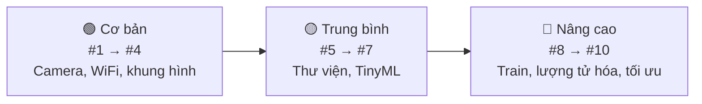

<div align="center">

# 📷 ESP32-CAM Image Processing

**10 bài toán xử lý ảnh trên ESP32-CAM, từ ví dụ có sẵn đến TinyML và ESP-DL**

[](https://platformio.org/)
[](https://www.espressif.com/)
[](https://github.com/espressif/arduino-esp32)
[](https://github.com/espressif/esp-idf)
[](LICENSE)

[Giới thiệu](#-giới-thiệu) •
[Bắt đầu](#-bắt-đầu) •
[Arduino IDE](#-dùng-arduino-ide) •
[Lộ trình](#️-lộ-trình) •
[Chi tiết bài](#-chi-tiết-từng-bài) •
[Cấu trúc](#-cấu-trúc-repo) •
[Đóng góp](#-đóng-góp)

</div>

---

## 📖 Giới thiệu

Repo này lần lượt giải **10 bài toán xử lý ảnh trên ESP32-CAM (AI-Thinker)**, xếp từ dễ đến khó:

- **Cơ bản:** chạy ví dụ có sẵn và tự viết xử lý ảnh cổ điển (trừ khung hình, lọc màu).
- **Trung bình:** dùng thư viện ngoài và các mô hình TinyML có sẵn.
- **Nâng cao:** tự thu dữ liệu, train, lượng tử hóa và tối ưu mô hình bằng TFLite Micro và ESP-DL.

Mỗi bài nằm trong `projects/NN_ten_bai/` và được chọn bằng một env trong `platformio.ini` ở gốc repo. Các bài Arduino còn có sẵn **sketch cho Arduino IDE** trong [`arduino/`](arduino/README.md). README của từng bài ghi cách chạy, kết quả và số đo (FPS, RAM, độ chính xác).

## 🚀 Bắt đầu

### Phần cứng

| Thành phần | Ghi chú |
|---|---|
| ESP32-CAM AI-Thinker | ESP32 + 4 MB PSRAM, cảm biến OV2640 |
| Mạch nạp USB-TTL hoặc ESP32-CAM-MB | Khi nạp phải nối GPIO0 xuống GND (bo MB tự làm việc này) |
| Nguồn 5V ≥ 1A | Nguồn yếu dễ gây brownout khi bật WiFi và camera cùng lúc |

### Phần mềm

- [VS Code](https://code.visualstudio.com/) + extension [PlatformIO IDE](https://platformio.org/install/ide?install=vscode) (khuyên dùng: tự tải đúng phiên bản core cho từng bài), **hoặc** [Arduino IDE 2.x](https://www.arduino.cc/en/software) (xem [Dùng Arduino IDE](#-dùng-arduino-ide))
- [ESP-IDF 6.1](https://docs.espressif.com/projects/esp-idf/en/latest/esp32/get-started/) (chỉ cho bài #6, #10)
- Python 3.10+ (cho các script trong `tools/`, bài #7–#10)
- Tài khoản [Edge Impulse](https://edgeimpulse.com/) (bài #7, #8)

### Cài đặt

```bash
git clone git@github.com:HuYingTran/ESP32Cam_Image_Processing.git        # SSH
# hoặc: git clone https://github.com/HuYingTran/ESP32Cam_Image_Processing.git
cd ESP32Cam_Image_Processing
```

Tạo file chứa thông tin WiFi từ file mẫu:

```bash
cp common/secrets.example.h common/secrets.h
# Sửa WIFI_SSID và WIFI_PASSWORD trong common/secrets.h
```

Chưa tạo `secrets.h` thì vẫn build được (trình biên dịch báo warning, dùng tạm `secrets.example.h`); khi đó board không vào được WiFi nhà và tự phát AP như mục dưới.

### ⚙️ Cấu hình

| Muốn đổi | Sửa ở đâu |
|---|---|
| Tên và mật khẩu WiFi | `common/secrets.h` |
| WiFi dự phòng (AP), timeout kết nối | `common/config.h` |
| Board camera, độ phân giải, chất lượng JPEG, lật ảnh | `common/config.h` |
| **Bài nào được build** | `default_envs` trong `platformio.ini`, hoặc chọn env trên thanh trạng thái VS Code |
| **Mô hình, ngưỡng của từng bài** | `projects/NN_xxx/src/lesson_config.h` |
| Cấu hình bài #6 (ESP-IDF) | `projects/06_person_detection/main/lesson_config.h`, `sdkconfig.defaults` |

> [!TIP]
> Nếu không kết nối được WiFi trong `WIFI_CONNECT_TIMEOUT_MS`, board sẽ tự phát WiFi `ESP32-CAM` (mật khẩu `12345678`). Khi đó vào `http://192.168.4.1`.

### Build và nạp một bài

Mở **thư mục gốc repo** bằng VS Code, chọn env (ví dụ `env:01_face_detection`) trên thanh trạng thái rồi bấm Upload. Nếu dùng dòng lệnh:

```bash
pio run -e 01_face_detection -t upload   # build + nạp
pio device monitor                       # xem Serial (115200 baud)
```

| Env | Bài |
|---|---|
| `01_face_detection` … `05_qr_reader` | Bài #1 → #5 |
| `07_capture` | Firmware thu ảnh train của bài #7 |

Bài #6 là project ESP-IDF riêng, build bằng `idf.py` trong `projects/06_person_detection/` (xem [README bài #6](projects/06_person_detection/README.md)).

> [!IMPORTANT]
> Bài #1 cần **Arduino core 2.0.x**, vì core 3.x đã bỏ face detection khỏi ví dụ `CameraWebServer`. Env mặc định ghim `platform = espressif32@7.1.3` (gói core 2.0.17).
>
> Trên ESP32 thường (không phải S3), core 2.0.x chỉ bật **Face Detection**; *Face Recognition* bị tắt. Vì vậy env của bài #2 riêng ghim `platform = espressif32@3.5.0` (Arduino core **1.0.6**, thư viện esp-face).

## 🧰 Dùng Arduino IDE

Thư mục [`arduino/`](arduino/README.md) chứa sketch tương ứng với từng bài Arduino. Mỗi sketch tự chứa đủ code (gồm cả `config.h`, `camera_init`, `wifi_init` và quirc cho bài #5), mở bằng **File → Open** là build được, không cần cài thêm thư viện.

| Sketch | Bài | Core esp32 (Boards Manager) |
|---|---|:-:|
| [`01_face_detection`](arduino/01_face_detection/) | #1 Phát hiện khuôn mặt | 2.0.17 |
| [`02_face_recognition`](arduino/02_face_recognition/) | #2 Nhận dạng khuôn mặt | **1.0.6** |
| [`03_motion_detection`](arduino/03_motion_detection/) | #3 Phát hiện chuyển động | 2.0.17 |
| [`04_color_tracking`](arduino/04_color_tracking/) | #4 Bám màu | 2.0.17 |
| [`05_qr_reader`](arduino/05_qr_reader/) | #5 Đọc mã QR | 2.0.17 |
| [`07_capture`](arduino/07_capture/) | #7 Thu ảnh train | 2.0.17 |

Cài đặt chung: **Tools → Board → AI Thinker ESP32-CAM**, Partition Scheme **Huge APP**, Core Debug Level **Info**, Serial Monitor 115200 baud. WiFi: thêm tab `secrets.h` (chép từ `secrets.example.h`). Chi tiết và lỗi thường gặp: [arduino/README.md](arduino/README.md).

> [!NOTE]
> Bài #6 (và #10) dùng ESP-IDF nên không có sketch Arduino IDE.
>
> Code gốc nằm ở `projects/` và `common/`; `arduino/` được sinh bằng `python tools/make_arduino_sketches.py`. Sửa code ở `projects/` rồi chạy lại script để đồng bộ.

## 🗺️ Lộ trình

| # | Bài toán | Công cụ | Framework | Độ khó | Trạng thái |
|:-:|---|---|---|:-:|:-:|
| 1 | [Phát hiện khuôn mặt](projects/01_face_detection/README.md) | CameraWebServer | Arduino 2.0.x | ⭐ | 🟨 |
| 2 | [Nhận dạng khuôn mặt](projects/02_face_recognition/README.md) | CameraWebServer 1.0.6 (Enroll) | Arduino 1.0.6 | ⭐ | 🟨 |
| 3 | [Phát hiện chuyển động](projects/03_motion_detection/README.md) | Tự viết: trừ nền theo block 8×8 | Arduino 2.0.x | ⭐⭐ | 🟨 |
| 4 | [Bám màu, đếm pixel](projects/04_color_tracking/README.md) | Tự viết (RGB565 / HSV) | Arduino 2.0.x | ⭐⭐ | 🟨 |
| 5 | [Đọc mã QR](projects/05_qr_reader/README.md) | quirc (từ ESP32QRCodeReader) | Arduino 2.0.x | ⭐⭐⭐ | 🟨 |
| 6 | [Phát hiện có người](projects/06_person_detection/README.md) | esp-tflite-micro + ESP-NN | ESP-IDF 6.1 | ⭐⭐⭐ | 🟨 |
| 7 | [Phân loại ảnh tự huấn luyện](projects/07_image_classification/README.md) | Edge Impulse (MobileNet) | Arduino | ⭐⭐⭐⭐ | 🟨 |
| 8 | [Phát hiện và đếm vật thể](projects/08_fomo_object_counting/README.md) | Edge Impulse FOMO | Arduino | ⭐⭐⭐⭐ | ⬜ |
| 9 | [Nhận diện chữ số](projects/09_digit_recognition/README.md) | CNN tự train + TFLite Micro | Arduino / ESP-IDF | ⭐⭐⭐⭐⭐ | ⬜ |
| 10 | [Pipeline ESP-WHO / ESP-DL](projects/10_esp_dl_pipeline/README.md) | ESP-IDF + ESP-DL | ESP-IDF | ⭐⭐⭐⭐⭐ | ⬜ |

<sub>⬜ Chưa làm · 🟨 Đang làm · ✅ Hoàn thành</sub>



## 📚 Chi tiết từng bài

Mỗi bài có README riêng (mục tiêu, kiến thức cần biết, thiết kế, các bước, tiêu chí hoàn thành, bảng kết quả, khó khăn thường gặp, tham khảo). Dưới đây là tóm tắt.

<details>
<summary><b>#1 Phát hiện khuôn mặt</b></summary>

### #1 Phát hiện khuôn mặt

📄 **[README chi tiết](projects/01_face_detection/README.md)**

- **Mục tiêu:** chạy ví dụ `CameraWebServer`, bật *Face Detection* trên giao diện web.
- **Vì sao dễ:** có sẵn trong ví dụ, chỉ cần nạp code, không phải tự viết.
- **Hoàn thành khi:** stream chạy ổn định và khung mặt được vẽ đúng.

</details>

<details>
<summary><b>#2 Nhận dạng khuôn mặt</b></summary>

### #2 Nhận dạng khuôn mặt

📄 **[README chi tiết](projects/02_face_recognition/README.md)**

- **Mục tiêu:** bật *Face Recognition*, bấm *Enroll* để lưu vài khuôn mặt rồi kiểm tra nhận dạng.
- **Thêm so với #1:** quy trình enroll, lưu khuôn mặt vào flash, tự so khớp bằng cosine similarity; dùng core 1.0.6, độ phân giải ≤ CIF.
- **Hoàn thành khi:** nhận đúng ít nhất 2 người đã enroll, báo `Intruder` với người lạ.

</details>

<details>
<summary><b>#3 Phát hiện chuyển động</b></summary>

### #3 Phát hiện chuyển động

📄 **[README chi tiết](projects/03_motion_detection/README.md)**

- **Mục tiêu:** chụp ảnh `GRAYSCALE` ở QQVGA (160×120), so với ảnh nền và đếm số block thay đổi.
- **Kỹ thuật:** downsample theo block 8×8, nền cập nhật chậm (running average), bù độ sáng, xác nhận N khung + cooldown, trang web tô các block thay đổi.
- **Hoàn thành khi:** báo chuyển động qua Serial/web, ít báo nhầm khi ánh sáng thay đổi nhẹ.

</details>

<details>
<summary><b>#4 Bám màu, đếm pixel theo ngưỡng</b></summary>

### #4 Bám màu, đếm pixel theo ngưỡng

📄 **[README chi tiết](projects/04_color_tracking/README.md)**

- **Mục tiêu:** chụp `RGB565`, chuyển sang HSV, lọc theo khoảng màu, tìm trọng tâm và bounding box.
- **Kỹ thuật:** tách byte RGB565 (chú ý endian), HSV số nguyên, erode/dilate 3×3, trang web bấm vào vật để lấy màu.
- **Hoàn thành khi:** in ra tọa độ trọng tâm của một vật màu và vẽ khung lên stream.

</details>

<details>
<summary><b>#5 Đọc mã QR</b></summary>

### #5 Đọc mã QR

📄 **[README chi tiết](projects/05_qr_reader/README.md)**

- **Mục tiêu:** giải mã QR bằng quirc (lấy từ thư viện `ESP32QRCodeReader`) trong một task FreeRTOS riêng, có trang web xem ảnh để chỉnh nét.
- **Khó ở chỗ:** chỉnh lấy nét, độ phân giải, độ sáng và độ tương phản để đọc ổn định.
- **Hoàn thành khi:** đọc được QR ở khoảng cách 10–30 cm trong điều kiện ánh sáng phòng.

</details>

<details>
<summary><b>#6 Phát hiện có người</b></summary>

### #6 Phát hiện có người

📄 **[README chi tiết](projects/06_person_detection/README.md)**

- **Mục tiêu:** chạy ví dụ `person_detection` của **esp-tflite-micro** trên ESP-IDF 6.1 (`idf.py`, project riêng trong thư mục bài).
- **Khó ở chỗ:** làm quen ESP-IDF và component manager, đưa ảnh về 96×96 xám int8, so sánh có/không **ESP-NN**; tự kiểm tra trên 10 ảnh mẫu lúc khởi động.
- **Hoàn thành khi:** in ra điểm `person` / `no person`, có số đo thời gian suy luận khi bật và tắt ESP-NN.

</details>

<details>
<summary><b>#7 Phân loại ảnh tự huấn luyện</b></summary>

### #7 Phân loại ảnh tự huấn luyện

📄 **[README chi tiết](projects/07_image_classification/README.md)**

- **Mục tiêu:** thu ảnh bằng chính ESP32-CAM, gán nhãn, train MobileNet trên **Edge Impulse**, xuất thư viện Arduino.
- **Khó ở chỗ:** chất lượng dữ liệu; chọn input (96×96 / 64×64) và mô hình sao cho vừa RAM/PSRAM.
- **Hoàn thành khi:** phân loại ≥ 3 lớp, độ chính xác thực tế ≥ 85%.

</details>

<details>
<summary><b>#8 Phát hiện và đếm vật thể (FOMO)</b></summary>

### #8 Phát hiện và đếm vật thể (FOMO)

📄 **[README chi tiết](projects/08_fomo_object_counting/README.md)**

- **Mục tiêu:** dùng **FOMO** trên Edge Impulse để định vị và đếm vật thể.
- **Khó hơn #7:** phải vẽ khung từng vật khi gán nhãn, cần nhiều dữ liệu hơn, khó đạt độ chính xác cao.
- **Hoàn thành khi:** đếm đúng số vật trong khung hình, sai lệch ≤ 1.

</details>

<details>
<summary><b>#9 Nhận diện chữ số</b></summary>

### #9 Nhận diện chữ số

📄 **[README chi tiết](projects/09_digit_recognition/README.md)**

- **Mục tiêu:** đọc số trên đồng hồ nước hoặc màn hình LED 7 đoạn.
- **Pipeline:** cố định ROI → cắt từng chữ số → CNN nhỏ (Keras) → lượng tử hóa **int8** → `xxd -i` ra mảng C → TFLite Micro.
- **Hoàn thành khi:** đọc đúng toàn bộ chuỗi số trong ≥ 90% lần thử.

</details>

<details>
<summary><b>#10 Tự viết pipeline ESP-WHO / ESP-DL</b></summary>

### #10 Tự viết pipeline ESP-WHO / ESP-DL

📄 **[README chi tiết](projects/10_esp_dl_pipeline/README.md)**

- **Mục tiêu:** pipeline trên ESP-IDF: camera → tiền xử lý → mô hình ESP-DL → hậu xử lý → hiển thị/gửi kết quả.
- **Khó nhất:** cấu hình `sdkconfig`, quản lý PSRAM, chuyển mô hình riêng bằng công cụ lượng tử hóa của ESP-DL, tối ưu dual-core / FreeRTOS / DMA.
- **Hoàn thành khi:** chạy được mô hình tự chuyển đổi, đo FPS và so sánh với #6, #8.

</details>

## 📁 Cấu trúc repo

```
ESP32Cam_Image_Processing/
├── platformio.ini               # Một env cho mỗi bài, chọn bài bằng default_envs
├── common/                      # Dùng chung cho các bài Arduino
│   ├── config.h                 # WiFi, board camera, thông số chụp ảnh
│   ├── secrets.example.h        # Mẫu thông tin WiFi (copy thành secrets.h)
│   ├── camera_pins.h            # Sơ đồ chân các board camera
│   └── esp32cam/                # Thư viện dùng chung từ bài #3 (core 2.0.x)
│       ├── camera_init.h/.cpp   # cameraInit(format, framesize, fb_count)
│       └── wifi_init.h/.cpp     # wifiInit(): vào WiFi, lỗi thì phát AP
├── projects/
│   ├── 01_face_detection/
│   │   ├── README.md
│   │   └── src/
│   │       ├── lesson_config.h  # Cấu hình riêng của bài (mô hình...)
│   │       └── main.cpp ...
│   ├── 02_face_recognition/
│   ├── 03_motion_detection/
│   ├── 04_color_tracking/
│   ├── 05_qr_reader/
│   ├── 06_person_detection/     # ESP-IDF (project riêng)
│   ├── 07_image_classification/
│   ├── 08_fomo_object_counting/
│   ├── 09_digit_recognition/
│   └── 10_esp_dl_pipeline/      # ESP-IDF (project riêng)
├── arduino/                     # Sketch Arduino IDE, sinh từ projects/ + common/
│   ├── README.md                # Cài đặt Arduino IDE, chọn core cho từng bài
│   ├── 01_face_detection/       # 01_face_detection.ino + main.cpp + config.h ...
│   ├── ...
│   └── 07_capture/
├── tools/
│   ├── make_arduino_sketches.py # Sinh lại arduino/ (--check: báo sketch lệch với nguồn)
│   ├── face_log_stats.py        # #2: thống kê similarity từ log Serial
│   ├── qr_test_sheet.py         # #5: tạo trang QR để in thử
│   ├── person_eval.py           # #6: đo độ chính xác trên cảnh thật qua Serial
│   ├── person_snapshot.py       # #6: lấy ảnh 96×96 model đang thấy
│   └── capture_images.py        # #7: tải ảnh train theo nhãn
├── docs/                        # Ghi chép, ảnh kết quả, số đo hiệu năng
├── LICENSE
└── README.md
```

<details>
<summary><b>Thêm một bài mới vào <code>platformio.ini</code></b></summary>

Các bài Arduino dùng chung phần `[env]` (platform, board, `-I common`), nên chỉ cần thêm:

```ini
[env:04_color_tracking]
build_src_filter = +<04_color_tracking/src/>
```

Trong code, `#include "camera_init.h"` và `"wifi_init.h"` để dùng lại phần khởi tạo camera và WiFi. `platformio.ini` đặt `lib_dir = common`, nên `common/esp32cam/` là một thư viện và chỉ được build khi có bài include nó.

Các bài ESP-IDF (#6, #10) cần CMake riêng nên là project ESP-IDF độc lập trong thư mục của bài, build bằng `idf.py` (xem README của bài).

</details>

## ⚠️ Lưu ý phần cứng

> [!WARNING]
> **Brownout:** lỗi `Brownout detector was triggered` gần như luôn do nguồn yếu. Hãy dùng nguồn 5V tốt. Chỉ tắt brownout detector để chẩn đoán, không dùng làm cách sửa.

- **PSRAM:** bật `-DBOARD_HAS_PSRAM` và dùng `fb_location = CAMERA_FB_IN_PSRAM` khi chụp ảnh lớn hoặc `fb_count > 1`.
- **Chân dùng chung:** GPIO4 (đèn flash) dùng chung với thẻ SD. GPIO0 phải thả nổi khi chạy bình thường.
- **Flash:** bài có model lớn dùng `board_build.partitions = huge_app.csv`.

## 🤝 Đóng góp

Mọi issue và pull request đều được hoan nghênh.

1. Fork repo
2. Tạo branch: `git checkout -b feature/ten-tinh-nang`
3. Commit: `git commit -m "feat(03): them nguong thich nghi"`
4. Push và mở Pull Request

**Quy ước:**

- Thư mục bài đặt tên `NN_ten_bai` (snake_case, số thứ tự 2 chữ số).
- Không commit `secrets.h`, dữ liệu train hay model lớn; ghi link tải trong README của bài.
- Làm xong một bài thì cập nhật cột **Trạng thái** ở [Lộ trình](#️-lộ-trình).
- Sửa code bài Arduino ở `projects/` hoặc `common/`, rồi chạy `python tools/make_arduino_sketches.py` để cập nhật `arduino/` trong cùng commit. Kiểm tra bằng `python tools/make_arduino_sketches.py --check`.

## 🙏 Tham khảo

- [espressif/arduino-esp32](https://github.com/espressif/arduino-esp32): ví dụ `CameraWebServer`
- [espressif/esp32-camera](https://github.com/espressif/esp32-camera): driver camera
- [espressif/esp-tflite-micro](https://github.com/espressif/esp-tflite-micro): TFLite Micro + ESP-NN
- [espressif/esp-who](https://github.com/espressif/esp-who) và [espressif/esp-dl](https://github.com/espressif/esp-dl)
- [alvarowolfx/ESP32QRCodeReader](https://github.com/alvarowolfx/ESP32QRCodeReader)
- [Edge Impulse Docs](https://docs.edgeimpulse.com/)

## 📄 License

Phát hành theo giấy phép [MIT](LICENSE).
