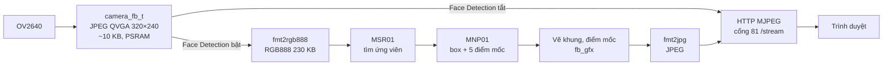
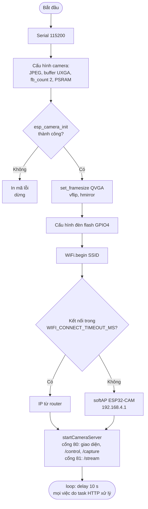
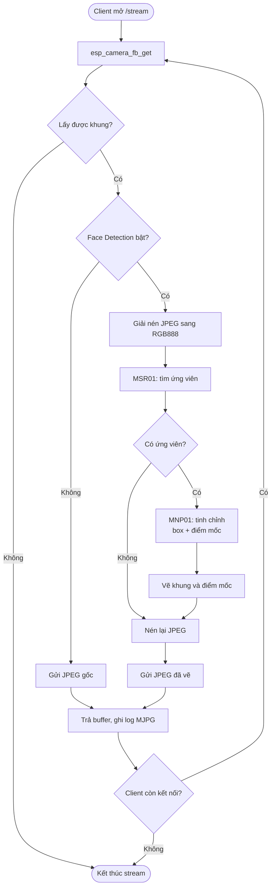

# #1 Phát hiện khuôn mặt

> **Độ khó:** ⭐ · **Framework:** Arduino core 2.0.17 · **Env:** `01_face_detection` · **Trạng thái:** 🟨 Đang làm

Chạy ví dụ `CameraWebServer` của arduino-esp32 **2.0.17** trên ESP32-CAM AI-Thinker, rồi bật *Face Detection* trên giao diện web.

## Mục tiêu

- Làm quen với quy trình build, nạp và xem Serial của ESP32-CAM.
- Hiểu luồng dữ liệu camera → `camera_fb_t` → JPEG → HTTP stream (MJPEG).
- Chạy mô hình phát hiện khuôn mặt có sẵn của ESP-DL và đo hiệu năng.

## Cách hoạt động

1. Camera chụp ảnh JPEG; khi bật face detection, độ phân giải phải ≤ QVGA (320×240).
2. Khi bật *Face Detection*, mỗi khung JPEG được giải nén sang RGB888.
3. Mô hình hai tầng của ESP-DL tìm khuôn mặt và 5 điểm mốc (mắt, mũi, khóe miệng):
   - `HumanFaceDetectMSR01`: tìm vùng có thể là khuôn mặt.
   - `HumanFaceDetectMNP01`: tinh chỉnh vùng đó.
4. Khung mặt và các điểm mốc được vẽ lên ảnh, ảnh được nén lại thành JPEG và stream qua HTTP (MJPEG).

## Pipeline và lưu đồ giải thuật

### Pipeline xử lý



### Lưu đồ giải thuật: khởi động (`setup`)



### Lưu đồ giải thuật: mỗi khung khi stream (`stream_handler`)



## Cấu trúc

```
01_face_detection/
└── src/
    ├── lesson_config.h  # Chọn mô hình phát hiện khuôn mặt
    ├── main.cpp         # Khởi tạo camera + WiFi, khởi động web server
    ├── app_httpd.cpp    # HTTP server, stream, face detection (từ ví dụ gốc)
    └── camera_index.h   # Giao diện web (HTML nén gzip)
```

Dùng chung: `common/config.h` (WiFi, camera), `common/secrets.h`, `common/camera_pins.h`.

## Cấu hình

| Tham số | File | Mặc định | Ý nghĩa |
|---|---|---|---|
| `FACE_DETECT_TWO_STAGE` | `src/lesson_config.h` | `1` | `1`: MSR01 + MNP01 (chính xác, có điểm mốc) · `0`: chỉ MSR01 (nhanh hơn) |
| `CAM_FRAME_SIZE` | `common/config.h` | `FRAMESIZE_QVGA` | Độ phân giải lúc khởi động; phải ≤ QVGA thì mới bật được face detect |
| `CAM_VFLIP` / `CAM_HMIRROR` | `common/config.h` | `0` | Lật ảnh |
| `WIFI_SSID` / `WIFI_PASSWORD` | `common/secrets.h` | | WiFi cần kết nối |

## Chạy

```bash
# Ở thư mục gốc repo, chỉ làm một lần
cp common/secrets.example.h common/secrets.h   # sửa SSID và mật khẩu

pio run -e 01_face_detection -t upload
pio device monitor
```

Serial sẽ in ra:

```
WiFi connected
Face detect model: MSR01 + MNP01 (two-stage)
Camera Ready! Use 'http://192.168.x.x' to connect
```

Mở địa chỉ đó trên trình duyệt:

1. **Resolution:** chọn `QVGA(320x240)` hoặc thấp hơn (`240x240`, `HQVGA`, `QQVGA`...).
2. Bấm **Start Stream**.
3. Bật **Face Detection**.

> [!NOTE]
> Trên ESP32 thường, core 2.0.x chỉ bật **Face Detection**. Nút *Face Recognition* / *Enroll* bị tắt vì chỉ được hỗ trợ trên ESP32-S3; trên ESP32 thường, mỗi khung mất tới khoảng 15 giây để xử lý.

## Tiêu chí hoàn thành

- [x] Build và nạp thành công
- [x] Kết nối WiFi, mở được giao diện web
- [x] Phát hiện được khuôn mặt (`DETECTED` trong log)
- [ ] Stream ổn định, khung mặt và điểm mốc được vẽ đúng trên trình duyệt
- [ ] Có số đo FPS khi bật / tắt face detect, mô hình một tầng / hai tầng

## Kết quả

| Hạng mục | Giá trị |
|---|---|
| Build | ✅ RAM 21.8% (71 KB), Flash 48.2% (1.5 MB / 3 MB) |
| Khởi động (PSRAM, WiFi, web server) | ✅ |
| Get Still có bật face detect, hai tầng | ✅ `DETECTED`, 3663 ms / ảnh (12.5 KB JPEG) |
| FPS khi stream QVGA, chưa bật face detect | _chưa đo_ |
| FPS khi stream QVGA, bật face detect hai tầng | ~0.8 fps (12 khung trong 13.6 s, tính từ timestamp log) |
| Thời gian xử lý / khung (`ready + face + recog + encode`) | ~500 ms = 95 + **~283** + 0 + 117 |
| Thời gian detect khi tầng 1 không tìm thấy mặt | ~59 ms (bỏ qua tầng MNP01) |

Phân tích từ log:

- Khi stream, phần detect chỉ mất khoảng 283 ms. Get Still mất 3663 ms vì đó là lần detect đầu tiên sau khi bật.
- Xử lý mỗi khung mất khoảng 500 ms, nhưng thực tế các khung cách nhau trung bình 1240 ms (từ 0.55 s đến 3.3 s). Phần chênh lệch có thể là thời gian gửi ảnh qua WiFi; cần đo thêm để chắc chắn.
- Số FPS in trong log cũ (0.1–0.3 fps) bị sai do lỗi của ví dụ gốc, đã sửa ở `app_httpd.cpp` (xem phần Xử lý sự cố).

## Xử lý sự cố

| Lỗi | Nguyên nhân / cách sửa |
|---|---|
| `Camera init failed with error 0x105` | Cáp camera lỏng hoặc sai board camera trong `common/config.h` |
| `Brownout detector was triggered` | Nguồn yếu: dùng 5V ≥ 1A, không cấp nguồn qua 3.3V |
| Không vào được chế độ nạp | Nối GPIO0 xuống GND, nhấn RESET rồi upload |
| `Please select CIF or lower resolution...` | Độ phân giải đang > QVGA. Câu thông báo ghi sai: code JS dùng `framesize.value > 5`, nên chặn cả CIF. Chọn QVGA hoặc thấp hơn |
| `PSRAM not found` | Board lỗi hoặc không có PSRAM; face detection sẽ bị tắt |
| FPS trong log `MJPG:` giảm dần liên tục (`3980ms`, `5472ms`… tăng mãi) | Lỗi của ví dụ gốc: `last_frame` không được cập nhật, nên thời gian bị tính từ lúc bắt đầu stream. Đã sửa trong `app_httpd.cpp` |

## Tham khảo

- [arduino-esp32 2.0.17 – CameraWebServer](https://github.com/espressif/arduino-esp32/tree/2.0.17/libraries/ESP32/examples/Camera/CameraWebServer)
- [espressif/esp32-camera](https://github.com/espressif/esp32-camera): driver camera, `sensor.h` (bảng `framesize_t`)
- [espressif/esp-dl](https://github.com/espressif/esp-dl): mô hình `HumanFaceDetectMSR01` / `MNP01`

---

⬅️ [Về README chính](../../README.md) · ➡️ [#2 Nhận dạng khuôn mặt](../02_face_recognition/README.md)
