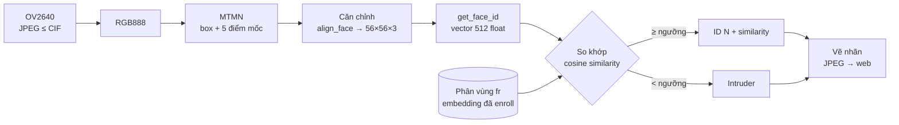
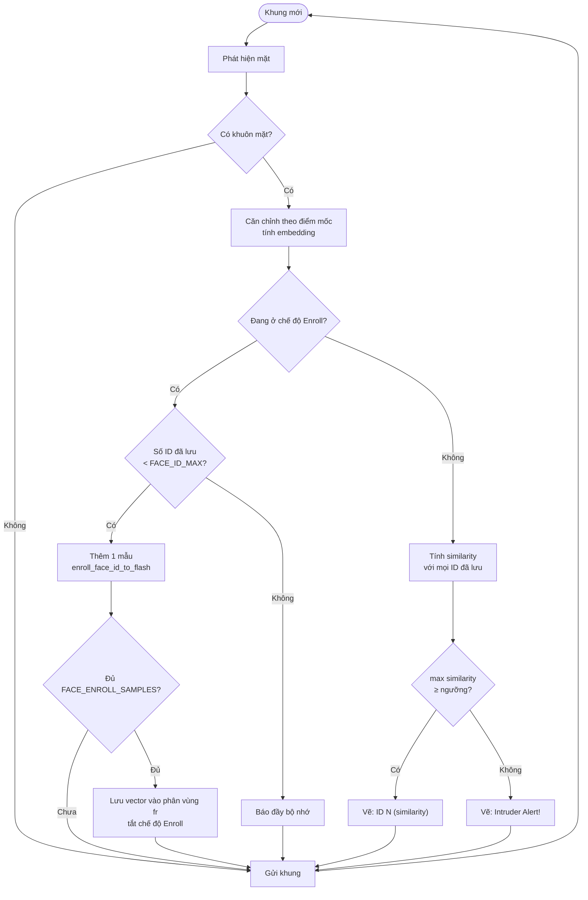

# #2 Nhận dạng khuôn mặt

> **Độ khó:** ⭐ · **Framework:** Arduino core **1.0.6** (platform `espressif32@3.5.0`) · **Env:** `02_face_recognition` · **Trạng thái:** 🟨 Đang làm

Lưu (enroll) khuôn mặt của vài người vào flash, sau đó camera nhận ra đúng từng người và cảnh báo khi gặp người lạ.

## Mục tiêu

- Phân biệt **phát hiện** (có khuôn mặt ở đâu) với **nhận dạng** (khuôn mặt đó là ai).
- Hiểu quy trình enroll: trích đặc trưng (embedding) → lưu → so khớp.
- Tự cài đặt bước so khớp bằng cosine similarity, chỉnh ngưỡng và đo độ chính xác.

## Vì sao dùng core 1.0.6?

> [!WARNING]
> Ví dụ `CameraWebServer` của **core 2.0.x tắt Face Recognition trên ESP32 thường**; chỉ ESP32-S3 được bật (ghi chú trong ví dụ: khoảng 15 giây/khung trên ESP32). Vì vậy bài này có env riêng, ghim `platform = espressif32@3.5.0` (Arduino core 1.0.6). Ở core này, thư viện **esp-face** hỗ trợ nhận dạng trên ESP32.

Đã cân nhắc thêm hai hướng khác: bật cưỡng bức recognition trên core 2.0.x (quá chậm) và dùng ESP-WHO trên ESP-IDF (để dành cho bài #10).

| Khác biệt so với bài #1 | Bài #1 (core 2.0.17) | Bài #2 (core 1.0.6) |
|---|---|---|
| Mô hình phát hiện | ESP-DL MSR01 + MNP01 | esp-face **MTMN** (P-Net → R-Net → O-Net) |
| Giới hạn độ phân giải trên web | ≤ QVGA (`framesize.value > 5`, QVGA = 5) | ≤ **CIF** (cùng điều kiện, nhưng CIF = 5) |
| Tên chân I2C camera | `pin_sccb_sda/scl` | `pin_sscb_sda/scl` |
| Đèn flash trên web | Có | Không |

## Kiến thức cần biết

### Các khái niệm

- **Căn chỉnh (align):** dùng 5 điểm mốc (2 mắt, mũi, 2 khóe miệng) để xoay và cắt khuôn mặt về ảnh chuẩn **56×56×3**.
- **Embedding (face ID):** mô hình nhận dạng biến ảnh 56×56 thành **vector 512 số thực**. Hai ảnh cùng một người cho ra hai vector gần nhau.
- **Enroll:** chụp `FACE_ENROLL_SAMPLES` ảnh của một người; vector lưu lại là tổng hợp các ảnh đó, giúp ổn định hơn một ảnh đơn lẻ.
- **So khớp:** cosine similarity giữa vector mới `a` và vector đã lưu `b`:

  $$\text{sim}(a, b) = \frac{a \cdot b}{\lVert a \rVert \, \lVert b \rVert} \in [-1, 1]$$

  Lấy ID có similarity lớn nhất; nếu nó ≥ `FACE_RECOGNITION_THRESHOLD` thì nhận, ngược lại là người lạ.

### Đánh đổi của ngưỡng

| Ngưỡng | Hậu quả |
|---|---|
| Cao | Ít nhận nhầm người lạ (FAR thấp), nhưng hay từ chối nhầm người quen (FRR cao) |
| Thấp | Ngược lại |

Log in ra similarity của **mọi lần** so khớp, kể cả khi không khớp, nên có thể ghi lại các giá trị rồi chọn ngưỡng dựa trên số liệu.

### Thay đổi so với ví dụ gốc

| Ví dụ gốc 1.0.6 | Bài này |
|---|---|
| `enroll_face()`: lưu trong RAM, mất khi khởi động lại | `enroll_face_id_to_flash()` + `read_face_id_from_flash()`: lưu trong phân vùng `fr` |
| `recognize_face()`: ngưỡng 0.55 cố định trong thư viện, không in similarity | `match_face()` tự viết: cosine similarity, ngưỡng trong `lesson_config.h`, in similarity |
| Không có cách xóa ID | `/control?var=face_delete_all&val=1` |
| In ID sai sau khi enroll xong (`tail` đã tăng) | Giữ `slot` trước khi enroll |
| Không kiểm tra danh sách đầy | Báo `ID list full` và dừng enroll |

## Pipeline và lưu đồ giải thuật

### Pipeline xử lý



### Lưu đồ giải thuật: mỗi khung



## Cấu trúc

```
02_face_recognition/
├── README.md
├── partitions.csv        # app 3.8 MB + phân vùng fr 128 KB (type/subtype 32)
└── src/
    ├── lesson_config.h   # Ngưỡng, số ID, số mẫu enroll, lưu flash
    ├── main.cpp          # Khởi tạo camera + WiFi (API core 1.0.6)
    ├── app_httpd.cpp     # Từ ví dụ 1.0.6, đã sửa phần enroll/recognize
    └── camera_index.h    # Giao diện web của 1.0.6
```

Dùng chung: `common/config.h`, `common/secrets.h`, `common/camera_pins.h`.

## Cấu hình

| Tham số | File | Mặc định | Ý nghĩa |
|---|---|---|---|
| `FACE_RECOGNITION_THRESHOLD` | `src/lesson_config.h` | `0.55` | Ngưỡng cosine similarity để nhận là cùng người |
| `FACE_ENROLL_SAMPLES` | `src/lesson_config.h` | `5` | Số ảnh cho mỗi lần enroll |
| `FACE_ID_MAX` | `src/lesson_config.h` | `7` | Số người tối đa |
| `FACE_SAVE_TO_FLASH` | `src/lesson_config.h` | `1` | `1`: lưu vào phân vùng `fr` · `0`: chỉ lưu RAM |
| `FACE_MIN_SIZE` | `src/lesson_config.h` | `80` | Kích thước mặt nhỏ nhất (pixel) MTMN tìm |
| `FACE_DETECT_TYPE` | `src/lesson_config.h` | `FAST` | `FAST` hoặc `NORMAL` (dùng ảnh tháp `FACE_PYRAMID`, chậm hơn) |
| `FACE_PYRAMID` / `FACE_PYRAMID_TIMES` | `src/lesson_config.h` | `0.707` / `4` | Tỉ lệ và số tầng ảnh tháp (chỉ có tác dụng với `NORMAL`) |
| `FACE_P_SCORE` / `FACE_R_SCORE` / `FACE_O_SCORE` | `src/lesson_config.h` | `0.6` / `0.7` / `0.7` | Ngưỡng điểm của 3 mạng MTMN; giảm thì dễ thấy mặt hơn nhưng dễ báo nhầm |
| `CAM_FRAME_SIZE` | `common/config.h` | `FRAMESIZE_QVGA` | Độ phân giải lúc khởi động; ≤ CIF |

## Chạy

```bash
pio run -e 02_face_recognition -t upload
pio device monitor
```

> [!NOTE]
> Lần build đầu tiên PlatformIO sẽ tải platform `espressif32@3.5.0` và core 1.0.6 (đã cài sẵn trên máy này).

Serial sẽ in ra:

```
WiFi connected
Loaded 0 face IDs from flash
Face recognition: max 7 IDs, 5 samples/enroll, threshold 0.55, flash on
Camera Ready! Use 'http://192.168.x.x' to connect
Delete all enrolled faces: http://192.168.x.x/control?var=face_delete_all&val=1
```

Trên giao diện web:

1. **Resolution:** `CIF(400x296)` hoặc thấp hơn, rồi **Start Stream**.
2. Bật **Face Detection**, sau đó bật **Face Recognition**.
3. Nhìn thẳng vào camera, bấm **Enroll Face**. Giữ yên mặt cho tới khi Serial in `Enrolled Face ID: 0`.
4. Lặp lại với người thứ hai (ID 1), thứ ba...
5. Đưa từng người vào khung: trên ảnh hiện `ID N (0.xx)`; người lạ hiện `Intruder Alert!`.

Log mẫu khi nhận dạng (số chỉ để minh họa định dạng):

```
Match Face ID: 0, similarity 0.78
No Match Found, best similarity 0.31 < 0.55
```

## Các bước thực hiện

- [x] Chọn hướng: core 1.0.6, tạo env `02_face_recognition`
- [x] Copy ví dụ `CameraWebServer` 1.0.6, áp dụng `common/config.h`
- [x] `partitions.csv` có phân vùng `fr`; lưu/đọc khuôn mặt từ flash
- [x] Tự viết so khớp cosine similarity, ngưỡng trong config
- [x] Build thành công
- [ ] Nạp, enroll 2–3 người
- [ ] Mỗi người thử 10 lần, thêm 10 lần với người lạ; ghi lại similarity
- [ ] Rút điện rồi cắm lại, kiểm tra `Loaded N face IDs from flash`
- [ ] Chọn lại ngưỡng dựa trên các similarity đã ghi

## Kịch bản kiểm thử

### Chuẩn bị

- 2 người đã biết (gọi là **A**, **B**) và 1 người lạ (**C**). Nếu chỉ có một mình, dùng ảnh khuôn mặt người khác trên điện thoại làm B và C. Cách này kém chính xác hơn người thật nhưng đủ để thử luồng chạy.
- Ánh sáng phòng bình thường, ngồi cách camera khoảng 30–50 cm.
- Mở Serial Monitor **có lưu file log** (đóng monitor trước mỗi lần Upload):

  ```powershell
  & "$env:USERPROFILE\.platformio\penv\Scripts\pio.exe" device monitor -e 02_face_recognition --port COM5 -f esp32_exception_decoder -f log2file
  ```

  Filter `log2file` ghi toàn bộ log ra file `platformio-device-monitor-<ngày-giờ>.log` trong thư mục gốc repo (đã có trong `.gitignore`). Sau mỗi bước, có thể đổi tên file để dễ phân biệt (ví dụ `log_A.log`).
- Trên web: **Start Stream** → bật **Face Detection** → bật **Face Recognition**. Không bấm **Get Still** trong lúc test.

### Các bước và kết quả mong đợi

| # | Bước | Log mong đợi trên Serial | Trên ảnh stream | Đạt khi |
|:-:|---|---|---|---|
| T0 | Khởi động lần đầu (bấm RST) | `Loaded 0 face IDs from flash` | | Không crash, số ID = 0 |
| T1 | **A** nhìn thẳng camera, bấm **Enroll Face** | `Control: face_enroll = 1`<br/>`Enrolling Face ID: 0 sample 1/5` … `5/5`<br/>`Enrolled Face ID: 0 (total 1)` | Chữ xanh lơ `ID[0] Sample[k]` | Có dòng `Enrolled Face ID: 0` |
| T2 | **B** làm như T1 | … `Enrolled Face ID: 1 (total 2)` | `ID[1] Sample[k]` | Có dòng `Enrolled Face ID: 1` |
| T3 | **Kiểm tra đã lưu vào flash:** rút điện hoặc bấm RST | `Loaded 2 face IDs from flash` | | Số ID = 2 (**đây là cách biết chắc khuôn mặt đã được lưu**) |
| T4 | **A** vào khung 10 lần (đi ra rồi vào lại, đổi góc nhẹ) | `Match Face ID: 0, similarity 0.xx` | Chữ xanh lá `ID 0 (0.xx)` | ≥ 8/10 lần đúng ID 0 |
| T5 | **B** làm như T4 | `Match Face ID: 1, similarity 0.xx` | `ID 1 (0.xx)` | ≥ 8/10 lần đúng ID 1 |
| T6 | **C** (người lạ) vào khung 10 lần | `No Match Found, best similarity 0.xx < 0.55` | Chữ đỏ `Intruder Alert!` | ≤ 1/10 lần bị nhận nhầm thành A hoặc B |
| T7 | (Tùy chọn) A đeo kính, nghiêng đầu, đèn yếu | | | Ghi lại để biết giới hạn |
| T8 | **Xóa:** mở `http://<ip>/control?var=face_delete_all&val=1`, rồi bấm RST | `Deleted all face IDs, remaining 0`<br/>sau RST: `Loaded 0 face IDs from flash` | A hiện `Intruder Alert!` | Số ID = 0 sau khi khởi động lại |
| T9 | (Tùy chọn) Enroll đủ 7 người, thử người thứ 8 | `Face ID list full (7), delete first` | `ID list full` | Không crash |

> [!NOTE]
> Mỗi khung hình có khuôn mặt sẽ in một dòng `Match ...` hoặc `No Match ...`. Một lần "vào khung" thường sinh ra nhiều dòng. T4–T6 nên tính theo **dòng** (mỗi khung một lần thử), dùng script ở dưới. Khi chưa enroll ai, log in `best similarity -1.00` vì không có gì để so.

### Tính kết quả từ log

Mỗi người thử (T4, T5, T6) lưu thành một file log riêng, rồi chạy:

```bash
python tools/face_log_stats.py log_A.log --expect 0
python tools/face_log_stats.py log_B.log --expect 1
python tools/face_log_stats.py log_C.log --expect none
```

Kết quả mẫu (số minh họa định dạng):

```
File: log_A.log  |  Người thử: ID 0  |  Số khung: 42
  Đúng            : 39/42 (93%)
  Từ chối nhầm    : 3/42 (7%)
  Nhầm sang ID khác: 0/42
  Similarity      : min 0.49  trung bình 0.71  max 0.84
```

### Chọn lại ngưỡng

So **similarity của người quen** (T4, T5) với **similarity của người lạ** (T6):

```
người lạ:  0.10 ─────── 0.40 (max)
người quen:                    0.50 (min) ─────── 0.85
                            ↑ ngưỡng nên nằm ở khoảng trống giữa hai dải
```

- Nếu hai dải tách nhau: đặt `FACE_RECOGNITION_THRESHOLD` ở giữa khoảng trống.
- Nếu hai dải chồng nhau: phải chọn giữa ít nhận nhầm (ngưỡng cao) và ít từ chối nhầm (ngưỡng thấp), hoặc enroll lại trong điều kiện ánh sáng tốt hơn.
- Có thể thử ngưỡng mới ngay trên log cũ, không cần nạp lại firmware: `--threshold 0.6`. Cách này chỉ đúng khi tăng ngưỡng; khi giảm ngưỡng, log không còn đủ thông tin.

## Tiêu chí hoàn thành

- T0–T3 đạt: enroll được ít nhất 2 người và còn sau khi khởi động lại.
- T4, T5 đạt: nhận đúng mỗi người ≥ 80% số khung.
- T6 đạt: người lạ bị nhận nhầm ≤ 10% số khung.
- Có số đo thời gian nhận dạng mỗi khung và đã chọn lại ngưỡng dựa trên similarity đo được.

## Kết quả

| Hạng mục | Giá trị |
|---|---|
| Hướng đã chọn | Arduino core 1.0.6, esp-face |
| Platform / core | `espressif32@3.5.0` / arduino-esp32 1.0.6 |
| Build | ✅ RAM 17.2% (56 KB), Flash 65.1% (2.5 MB / 3.8 MB) |
| Thời gian detect + recognize / khung | QVGA, FAST: detect ~200 ms, recognize ~850 ms. Có mặt ~1.4 s/khung (0.6 fps), không có mặt ~340 ms (2.3 fps) |
| Nhận đúng người đã enroll | _chưa đo_ (x/10 mỗi người) |
| Nhận nhầm người lạ (FAR) | _chưa đo_ (x/10) |
| Dữ liệu enroll còn sau khi khởi động lại | _chưa kiểm tra_ |
| Similarity người quen (min / trung bình) | 0.87 / 0.87 (2 khung ngay sau enroll, chưa đủ để kết luận) |
| Similarity người lạ (max / trung bình) | _chưa đo_ |

## Khó khăn thường gặp

| Vấn đề | Gợi ý |
|---|---|
| Không thấy nút Enroll / Recognition | Đang nạp nhầm env của bài #1 (core 2.0.x đã tắt tính năng này) |
| `Enroll failed (-2), check 'fr' partition` | Bảng phân vùng không có `fr`; kiểm tra `board_build.partitions` trong env |
| Bấm Enroll Face không có gì xảy ra | Enroll chỉ chạy khi **stream đang chạy** và MTMN thấy mặt. Xem dòng `Enroll waiting: ...` trên Serial để biết thiếu điều kiện nào |
| `CORRUPT HEAP: Bad head ... got 0x00000008` ngay sau khi thấy mặt | Lỗi của ví dụ gốc 1.0.6: `net_boxes` cấp phát bằng `dl_lib_calloc` nhưng giải phóng bằng `free()` ([arduino-esp32 #5128](https://github.com/espressif/arduino-esp32/issues/5128)). Repo đã sửa sang `dl_lib_free()` |
| Bài #1 thấy mặt nhưng bài #2 không thấy | Khác mô hình (MSR01/MNP01 so với MTMN). Xem log `Face: WxH px` khi thấy mặt; thử giảm `FACE_MIN_SIZE`, giảm `FACE_*_SCORE` hoặc dùng `NORMAL` |
| Enroll mãi không xong | Log báo `Face Not Aligned`: nhìn thẳng, đủ sáng, mặt ≥ `FACE_MIN_SIZE` pixel |
| `ID list full` | Đã đủ `FACE_ID_MAX` người; xóa bằng `face_delete_all` |
| Nhận dạng kém khi đổi ánh sáng | Enroll ở chính điều kiện ánh sáng sẽ dùng; tránh ngược sáng |
| Watchdog reset khi bật recognition | Xử lý quá lâu; giảm độ phân giải hoặc không stream liên tục |
| Mất ID sau khi nạp lại | Upload thường không ghi vào phân vùng `fr`, nhưng *Erase Flash* hoặc đổi bảng phân vùng thì có |

## Tham khảo

- [arduino-esp32 1.0.6 – CameraWebServer](https://github.com/espressif/arduino-esp32/tree/1.0.6/libraries/ESP32/examples/Camera/CameraWebServer)
- [arduino-esp32 2.0.17 – CameraWebServer](https://github.com/espressif/arduino-esp32/tree/2.0.17/libraries/ESP32/examples/Camera/CameraWebServer)
- [espressif/esp-who](https://github.com/espressif/esp-who)
- ArcFace / FaceNet: các bài báo gốc về face embedding

---

⬅️ [#1 Phát hiện khuôn mặt](../01_face_detection/README.md) · ➡️ [#3 Phát hiện chuyển động](../03_motion_detection/README.md)
