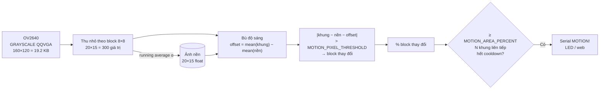
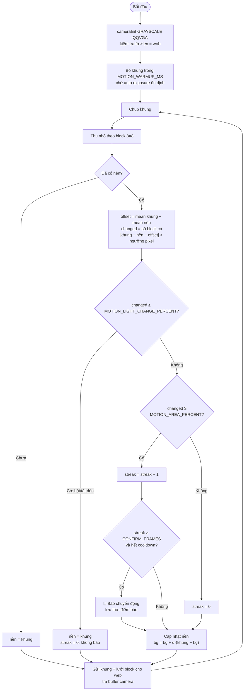

# #3 Phát hiện chuyển động

> **Độ khó:** ⭐⭐ · **Framework:** Arduino core 2.0.17 · **Env:** `03_motion_detection` · **Trạng thái:** 🟨 Đã có code, chưa thử trên board

Tự viết thuật toán phát hiện chuyển động bằng cách so sánh các khung ảnh xám, không dùng AI.

## Mục tiêu

- Lần đầu **tự đọc từng pixel** trong `camera_fb_t`.
- Hiểu định dạng `PIXFORMAT_GRAYSCALE` và cách bố trí bộ nhớ ảnh.
- Cài đặt frame differencing, background subtraction và lọc nhiễu.
- Viết lại phần khởi tạo camera thành `common/camera_init.h/.cpp` để dùng cho các bài sau.

## Kiến thức cần biết

### Ảnh xám trong bộ nhớ

Với `PIXFORMAT_GRAYSCALE`, mỗi pixel là 1 byte (0 = đen, 255 = trắng), lưu theo từng hàng:

```c
uint8_t *p = fb->buf;                 // fb->len == width * height
uint8_t pixel = p[y * fb->width + x];
```

QQVGA (160×120) = 19 200 byte/khung, đủ nhỏ để giữ vài khung trong RAM thường.

### Thuật toán

1. **Downsample theo block:** lấy trung bình mỗi block 8×8. Cách này vừa giảm nhiễu cảm biến vừa giảm khối lượng tính toán.
2. **Background subtraction:** so với ảnh nền chứ không chỉ với khung trước, để vật chuyển động chậm vẫn bị phát hiện.
3. **Running average** cập nhật nền:
   `bg = (1 − α)·bg + α·frame`, với α nhỏ (ví dụ 0.05). Nền thích nghi dần khi ánh sáng thay đổi chậm.
4. **Hai ngưỡng:**
   - Ngưỡng pixel: chênh lệch bao nhiêu thì coi một block là "thay đổi".
   - Ngưỡng diện tích: bao nhiêu % số block thay đổi thì coi là có chuyển động.
5. **Chống báo nhầm:** chỉ báo khi chuyển động kéo dài N khung liên tiếp; sau đó chờ một khoảng (cooldown) mới báo lần tiếp theo.

### Vì sao không dùng JPEG?

Muốn đọc pixel từ JPEG thì phải giải nén từng khung, rất tốn thời gian. Chụp thẳng ở dạng grayscale thì có ngay pixel, nhưng không stream JPEG trực tiếp được. Nếu cần xem hình, nén khung xám thành JPEG bằng `frame2jpg()` khi có người mở web.

## Pipeline và lưu đồ giải thuật

### Pipeline xử lý



### Lưu đồ giải thuật



## Thiết kế

```
common/esp32cam/              # thư viện dùng chung, tạo ở bài này
├── camera_init.h/.cpp        # cameraInit(format, framesize, fb_count, alloc_size)
└── wifi_init.h/.cpp          # wifiInit(): vào WiFi, lỗi thì phát AP

03_motion_detection/
├── README.md
└── src/
    ├── lesson_config.h   # Các ngưỡng, alpha, kích thước block, bật/tắt web/LED/plot
    ├── main.cpp          # Vòng lặp: chụp → phát hiện → báo, thống kê mỗi giây
    ├── motion.h/.cpp     # Thuật toán, không phụ thuộc Arduino/camera
    └── web.h/.cpp        # Trang web xem ảnh + tô block thay đổi + chỉnh ngưỡng
```

- **`MotionDetector`** (`motion.h`) nhận mảng ảnh xám `width×height` và trả về `MotionResult`: độ sáng trung bình, số/% block thay đổi, cờ `light_change`, `motion`, `alarm`. Mảng `mask()` cho biết block nào thay đổi.
- **Vòng lặp chính chạy trong `loop()`**, web server chạy trong task riêng. `webPublish()` chép khung mới nhất (19.2 KB) vào buffer riêng dưới mutex. Trang web nén JPEG từ bản sao này, nên không làm chậm vòng phát hiện.
- **Tham số sửa trên web** không ghi thẳng vào detector. Chúng được `loop()` áp dụng ở khung kế tiếp, để không đổi giữa lúc đang xử lý một khung.

### Cấu hình (`src/lesson_config.h`)

| Tham số | Mặc định | Sửa trên web | Ý nghĩa |
|---|---|:-:|---|
| `MOTION_FRAME_SIZE` | `FRAMESIZE_QQVGA` | | Độ phân giải xử lý |
| `MOTION_BLOCK_SIZE` | `8` | | Cạnh block khi thu nhỏ |
| `MOTION_PIXEL_THRESHOLD` | `15` | ✅ | Chênh lệch độ sáng tối thiểu của một block |
| `MOTION_AREA_PERCENT` | `5` | ✅ | % block thay đổi để coi là chuyển động |
| `MOTION_BG_ALPHA` | `0.05` | ✅ | Tốc độ cập nhật nền |
| `MOTION_CONFIRM_FRAMES` | `2` | ✅ | Số khung liên tiếp để xác nhận |
| `MOTION_COOLDOWN_MS` | `3000` | ✅ | Thời gian chờ giữa hai lần báo |
| `MOTION_LIGHT_CHANGE_PERCENT` | `80` | ✅ | Quá % này coi là bật/tắt đèn, lấy lại nền |
| `MOTION_NORMALIZE_BRIGHTNESS` | `1` | ✅ | Bù chênh lệch độ sáng trung bình |
| `MOTION_WARMUP_MS` | `3000` | | Bỏ các khung đầu |
| `MOTION_FLASH_LED` | `0` | | Nháy đèn flash GPIO4 khi báo |
| `MOTION_WEB` | `1` | | Bật WiFi + trang web |
| `MOTION_PLOT` | `0` | | `1`: in mỗi khung cho Serial Plotter |

Tham số sửa trên web chỉ có hiệu lực tới lần khởi động lại. Khi tìm được giá trị tốt, ghi lại vào `lesson_config.h`.

## Chạy

```powershell
& "$env:USERPROFILE\.platformio\penv\Scripts\pio.exe" run -e 03_motion_detection -t upload --upload-port COM5
& "$env:USERPROFILE\.platformio\penv\Scripts\pio.exe" device monitor -e 03_motion_detection --port COM5
```

Log khởi động mong đợi:

```
Frame: 160x120, 19200 bytes, format 3 (GRAYSCALE = 3)
Motion: grid 20x15 (block 8), pixel 15, area 5.0%, alpha 0.050, confirm 2, cooldown 3000 ms
WiFi connected
Web: http://192.168.x.x
Warming up 3000 ms...
24.8 fps, process 450 us/frame, brightness 112, changed max 0.7%
MOTION! 23.3% blocks changed (70), brightness 105
```

Mở `http://<ip>` để xem ảnh xám, các block thay đổi được tô đỏ. Trạng thái hiện **Yên tĩnh** / **CÓ CHUYỂN ĐỘNG** / **Đổi ánh sáng**.

> [!NOTE]
> Nạp bài này sẽ ghi đè firmware và bảng phân vùng của bài #2. Khi quay lại bài #2, có thể phải enroll lại khuôn mặt.

### Chọn ngưỡng

1. Để camera nhìn cảnh tĩnh khoảng 1 phút, xem `changed max` trên dòng thống kê. `MOTION_AREA_PERCENT` phải lớn hơn hẳn giá trị này.
2. Đi qua trước camera, xem `changed` trên web lên bao nhiêu. Ngưỡng nên nằm giữa hai giá trị.
3. Có nhiều nhiễu lấm tấm (block đỏ rải rác khi không có gì): tăng `pixel`. Người đi qua mà ít block đỏ: giảm `pixel`.
4. Muốn xem đồ thị: đặt `MOTION_PLOT 1`, nạp lại, mở Serial Plotter (VS Code: extension *Serial Plotter*, hoặc Arduino IDE).

### Kịch bản test

| # | Bước | Mong đợi |
|:-:|---|---|
| T1 | Khởi động, không có ai trong 1 phút | Không có `MOTION!`, `changed max` < `MOTION_AREA_PERCENT` |
| T2 | Đi qua trước camera 10 lần, cách nhau > 3 s | ≥ 9 dòng `MOTION!` |
| T3 | Vẫy tay nhỏ ở góc khung | Có thể không báo (diện tích nhỏ); ghi lại % `changed` |
| T4 | Bật/tắt đèn phòng 5 lần | `Light change ... background reset`, không có `MOTION!` |
| T5 | Kéo rèm từ từ / mây che nắng | Không báo, nền tự thích nghi |
| T6 | Đứng yên trong khung 30 s sau khi đi vào | Báo khi vào, sau đó người dần "hòa vào nền" (khoảng 1/α khung) |
| T7 | Để 10 phút không có người | Đếm số lần báo nhầm |

## Các bước thực hiện

- [x] Tạo `common/esp32cam/camera_init.h/.cpp` (khởi tạo camera với `pixformat` và `framesize` truyền vào)
- [x] Thêm env `03_motion_detection` vào `platformio.ini`
- [ ] Chụp grayscale QQVGA, in `fb->width`, `fb->height`, `fb->len` ra Serial để kiểm tra (code có, chờ chạy)
- [ ] In độ sáng trung bình của khung; che camera thì số này phải giảm
- [x] Cài đặt downsample, chênh lệch so với nền, đếm block thay đổi
- [ ] In % block thay đổi mỗi khung, vẽ bằng Serial Plotter để chọn ngưỡng
- [x] Thêm running average, xác nhận N khung và cooldown
- [x] (Tùy chọn) Trang web hiển thị ảnh và tô màu các block thay đổi
- [ ] Thử các tình huống: người đi qua, bật/tắt đèn, rèm lay động

## Tiêu chí hoàn thành

- Báo chuyển động qua Serial (và web, nếu làm) khi có người đi qua.
- Ít báo nhầm khi ánh sáng thay đổi chậm.
- Đạt ít nhất 10 fps xử lý ở QQVGA.

## Kết quả

| Hạng mục | Giá trị |
|---|---|
| Build | ✅ RAM 17.2% (56 KB), Flash 27.6% (867 KB / 3 MB) |
| FPS xử lý (QQVGA, không stream) | _chưa đo_ |
| Thời gian xử lý / khung | _chưa đo_ |
| Phát hiện người đi qua | _chưa đo_ (x/10) |
| Báo nhầm trong 10 phút không có người | _chưa đo_ |
| Báo nhầm khi bật/tắt đèn | _chưa đo_ |

## Khó khăn thường gặp

| Vấn đề | Gợi ý |
|---|---|
| Báo liên tục ngay sau khi khởi động | Auto exposure chưa ổn định; bỏ vài giây đầu và khởi tạo nền từ khung thứ N |
| Bật đèn là báo chuyển động | Đã có sẵn: bù độ sáng (`normalize`) và lấy lại nền khi ≥ `MOTION_LIGHT_CHANGE_PERCENT` block cùng đổi. Nếu vẫn báo, giảm `light` trên web |
| Người đứng yên một lúc thì mất | Đúng thiết kế: nền dần "học" người đó. Giảm `alpha` để nhớ nền lâu hơn |
| Web chậm, ảnh giật | Trang web tải ảnh khoảng 10 lần/giây và không ảnh hưởng tới fps xử lý; xem fps trên Serial |
| Nhiễu lấm tấm (ban đêm) | Tăng kích thước block hoặc ngưỡng pixel |
| `fb->len` không bằng `width × height` | Kiểm tra lại đã đặt `PIXFORMAT_GRAYSCALE` chưa |

## Tham khảo

- [espressif/esp32-camera](https://github.com/espressif/esp32-camera): `esp_camera_fb_get()`, `frame2jpg()`
- OpenCV docs: *Background Subtraction* (để hiểu ý tưởng, không dùng trên ESP32)

---

⬅️ [#2 Nhận dạng khuôn mặt](../02_face_recognition/README.md) · ➡️ [#4 Bám màu](../04_color_tracking/README.md)
