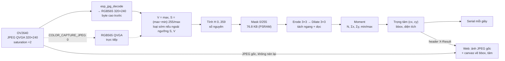
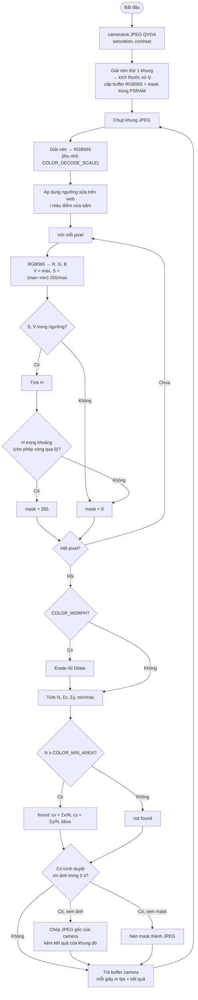

# #4 Bám màu, đếm pixel theo ngưỡng

> **Độ khó:** ⭐⭐ · **Framework:** Arduino core 2.0.17 · **Env:** `04_color_tracking` · **Trạng thái:** 🟨 Đã có code, chưa thử trên board

Tìm vật thể theo màu (ví dụ quả bóng đỏ): lọc pixel theo ngưỡng HSV, sau đó tính trọng tâm và khung bao.

## Mục tiêu

- Đọc ảnh màu **RGB565** và xử lý đúng thứ tự byte.
- Chuyển RGB sang **HSV** bằng số nguyên (không dùng float).
- Lọc nhiễu bằng phép hình thái học (erode/dilate).
- Tính **trọng tâm** (moment) và **bounding box** của vùng màu.
- Giải nén JPEG có thu nhỏ để có ảnh web nét mà vẫn xử lý nhanh.
- Hiển thị kết quả trên web.

## Kiến thức cần biết

### RGB565

Mỗi pixel gồm 2 byte: 5 bit đỏ, 6 bit xanh lá, 5 bit xanh dương. Driver camera trả về byte cao trước (big-endian), nên phải ghép lại:

```c
uint16_t px = (buf[2*i] << 8) | buf[2*i + 1];
uint8_t r = (px >> 11) & 0x1F;   // 0..31
uint8_t g = (px >> 5)  & 0x3F;   // 0..63
uint8_t b =  px        & 0x1F;   // 0..31
// Đưa về 0..255: r <<= 3; g <<= 2; b <<= 3;
```

> [!TIP]
> Nếu màu bị sai (đỏ thành xanh), gần như chắc chắn là ghép sai thứ tự byte.

### Vì sao dùng HSV thay vì RGB?

| Kênh | Ý nghĩa | Ích lợi |
|---|---|---|
| **H** (Hue) | Màu gì (0–360°) | Ít thay đổi khi độ sáng thay đổi, nên rất hợp để lọc màu |
| **S** (Saturation) | Độ đậm của màu | Loại bỏ vùng trắng, xám |
| **V** (Value) | Độ sáng | Loại bỏ vùng quá tối |

Màu đỏ nằm ở cả hai đầu dải Hue (gần 0° và gần 360°), nên phải lọc hai khoảng: `H < 15 || H > 345`.

### Trọng tâm và khung bao

- **Trọng tâm:** `cx = Σx / N`, `cy = Σy / N`, với N là số pixel thuộc mask.
- **Bounding box:** min/max của x và y trong mask.
- Nếu chỉ cần tìm vị trí, có thể **đếm theo block** thay cho erode/dilate: block nào có > 50% pixel đạt ngưỡng thì giữ.

## Pipeline và lưu đồ giải thuật

### Pipeline xử lý



### Lưu đồ giải thuật



## Thiết kế

```
04_color_tracking/
├── README.md
└── src/
    ├── lesson_config.h   # Nguồn ảnh, cảm biến, ngưỡng HSV, diện tích tối thiểu, web
    ├── main.cpp          # Chụp → (giải nén) → bám màu → giao ảnh cho web khi có người xem
    ├── color.h/.cpp      # RGB565 → HSV, mask, erode/dilate, moment (không phụ thuộc Arduino)
    └── web.h/.cpp        # Trang web: ảnh/mask + canvas vẽ kết quả, bấm lấy màu, chỉnh ngưỡng
```

### Hai nguồn ảnh

| | `COLOR_CAPTURE_JPEG 1` (mặc định) | `COLOR_CAPTURE_JPEG 0` |
|---|---|---|
| Camera chụp | JPEG QVGA 320×240 | RGB565 QVGA 320×240 |
| Ảnh để xử lý | Giải nén → RGB565 320×240 | Dùng thẳng buffer camera |
| Ảnh lên web | JPEG gốc của camera, không nén lại | Board nén lại bằng `frame2jpg()` |
| Chất lượng ảnh web | Màu đẹp, nén bằng phần cứng | Nhạt hơn, board tự nén lại |
| Tốn thêm | Giải nén mỗi khung | Nén JPEG khi có người xem |

Chế độ JPEG cho ảnh đẹp hơn vì OV2640 tự nén JPEG bằng phần cứng, ESP32 không phải nén lại. Muốn ảnh web nét hơn ảnh xử lý, chụp lớn hơn rồi thu nhỏ khi giải nén. Đổi lại, độ trễ tăng:

| `COLOR_CAPTURE_SIZE` + `COLOR_DECODE_SCALE` | Ảnh web | Ảnh xử lý | Độ trễ |
|---|---|---|---|
| `FRAMESIZE_QVGA` + `JPG_SCALE_NONE` (mặc định) | 320×240 | 320×240 | Thấp nhất |
| `FRAMESIZE_HVGA` + `JPG_SCALE_2X` | 480×320 | 240×160 | Trung bình |
| `FRAMESIZE_VGA` + `JPG_SCALE_2X` | 640×480 | 320×240 | Cao: ảnh lớn gấp ~4 lần, giải nén lâu hơn |

`COLOR_MIN_AREA` tính theo pixel của ảnh xử lý, nên khi đổi kích thước ảnh xử lý thì chỉnh lại giá trị này. Ở cả hai chế độ, `ColorTracker` đều nhận cùng một định dạng RGB565 byte cao trước. Bộ giải nén trả từng khối pixel RGB888 qua callback `jpegWrite()`, và hàm này tự ghép lại thành RGB565.

### Các điểm chính

- **Loại sớm theo S, V:** V và S chỉ cần max/min của R, G, B. Đa số pixel nền bị loại ở bước này nên không phải tính H, phép chia nặng nhất.
- **Erode/dilate tách lượt:** phép 3×3 trên mask nhị phân bằng AND/OR của 3 điểm theo hàng ngang, rồi 3 điểm theo cột dọc. Mỗi pixel chỉ cần 4 phép thay vì 9.
- **Kết quả vẽ trên trình duyệt:** `/frame.jpg` có header `X-Result` chứa `found,cx,cy,x0,y0,x1,y1` của đúng khung đó, theo tọa độ ảnh xử lý. Trình duyệt nhân với tỉ lệ ảnh web/ảnh xử lý rồi vẽ lên canvas. Nhờ vậy board không phải giải nén, vẽ rồi nén lại ảnh VGA.
- **Chỉ chuẩn bị ảnh web khi có người xem:** nếu trình duyệt không xin ảnh trong 2 giây gần nhất, `loop()` bỏ qua bước này. Không mở web thì fps in ra là fps xử lý thuần.
- **Bấm để lấy màu:** web gửi tọa độ điểm bấm. `loop()` lấy trung bình RGB vùng 5×5 quanh điểm đó, đổi sang HSV, rồi đặt ngưỡng `H ± COLOR_PICK_H_TOL`, `S ≥ S/2`, `V ≥ V/2`. Lấy trung bình RGB trước rồi mới đổi sang HSV, vì lấy trung bình H trực tiếp sẽ sai ở màu đỏ (vòng qua 0).

### Cấu hình (`src/lesson_config.h`)

| Tham số | Mặc định | Sửa trên web | Ý nghĩa |
|---|---|:-:|---|
| `COLOR_CAPTURE_JPEG` | `1` | | Nguồn ảnh (bảng trên) |
| `COLOR_CAPTURE_SIZE` | `FRAMESIZE_QVGA` | | Độ phân giải chụp ở chế độ JPEG |
| `COLOR_DECODE_SCALE` | `JPG_SCALE_NONE` | | Thu nhỏ khi giải nén: `NONE`, `2X`, `4X`, `8X` |
| `COLOR_FRAME_SIZE` | `FRAMESIZE_QVGA` | | Độ phân giải ở chế độ RGB565 |
| `COLOR_SATURATION` / `COLOR_CONTRAST` | `2` / `1` | | Chỉnh cảm biến (-2..2), tăng cho màu đậm |
| `COLOR_AWB` | `1` | ✅ | `0`: khóa white balance sau 2 giây đầu |
| `COLOR_H_MIN` / `COLOR_H_MAX` | `345` / `15` | ✅ | Khoảng Hue; `MIN > MAX` nghĩa là vòng qua 0 |
| `COLOR_S_MIN` / `COLOR_S_MAX` | `100` / `255` | ✅ | Độ bão hòa |
| `COLOR_V_MIN` / `COLOR_V_MAX` | `60` / `255` | ✅ | Độ sáng |
| `COLOR_MIN_AREA` | `200` | ✅ | Số pixel (ảnh xử lý) tối thiểu để coi là thấy vật |
| `COLOR_MORPH` | `1` | ✅ | Bật erode/dilate |
| `COLOR_PICK_H_TOL` | `15` | | Độ rộng khoảng H khi bấm lấy màu |
| `COLOR_WEB` | `1` | | Bật WiFi + trang web |
| `COLOR_JPEG_QUALITY` | `10` | | Chất lượng JPEG của camera (0–63, **nhỏ** = nét) |
| `COLOR_ENCODE_QUALITY` | `80` | | Chất lượng khi board tự nén mask / ảnh RGB565 (1–100, **lớn** = nét) |

## Chạy

```powershell
& "$env:USERPROFILE\.platformio\penv\Scripts\pio.exe" run -e 04_color_tracking -t upload --upload-port COM5
& "$env:USERPROFILE\.platformio\penv\Scripts\pio.exe" device monitor -e 04_color_tracking --port COM5
```

Log mong đợi:

```
Frame: 320x240, 8000 bytes, format 4
Source: JPEG 320x240 -> decode 1/1 -> process 320x240 RGB565
Color: H 345..15, S 100..255, V 60..255, min area 200, morph 1
Web: http://192.168.x.x
8.0 fps | decode 60.0 ms, mask 40.0 ms, morph 15.0 ms, moment 5.0 ms, web 0.0 ms | not found (0 px) | center HSV 30 40 120
7.5 fps | ... | FOUND center (161, 118) box (130,90)-(190,150) area 2850 | center HSV 356 190 170
```

(Các số ms ở trên chỉ minh họa định dạng, chưa phải số đo.)

Trên web (`http://<ip>`):

- **Ảnh:** khung xanh lá là bbox, dấu cộng hồng là trọng tâm.
- **Mask:** trắng là pixel đạt ngưỡng. Dùng chế độ này để chỉnh ngưỡng.
- **Bấm vào vật** trên ảnh để lấy màu, sau đó tinh chỉnh bằng các ô số.

> [!TIP]
> Cách lấy ngưỡng không cần web: đặt vật vào giữa khung, đọc `center HSV` trên Serial, rồi đặt H ± 15, S_MIN và V_MIN bằng khoảng một nửa giá trị đọc được.

### Kịch bản test

| # | Bước | Mong đợi |
|:-:|---|---|
| T1 | Kiểm tra màu: đặt vật đỏ, xanh lá, xanh dương vào giữa khung | `center HSV` có H ≈ 0/360, 120, 240. Đỏ và xanh dương bị đổi chỗ thì xem lại thứ tự R, B trong `jpegWrite()` |
| T2 | Không có vật, nền bình thường | `not found`, mask gần như đen |
| T3 | Đưa vật vào, di chuyển trái → phải, trên → dưới | `cx` tăng dần khi sang phải, `cy` tăng dần khi xuống dưới; khung trên web bám theo vật |
| T4 | Tắt erode/dilate, so sánh mask | Có thêm chấm lấm tấm, `area` lớn hơn một chút |
| T5 | Đổi ánh sáng (bật/tắt đèn, che bớt) | Ghi lại ngưỡng còn bám được; thử `awb` bật/tắt |
| T6 | Nền có màu gần giống (áo đỏ, đồ gỗ) | Ghi lại trường hợp nhận nhầm |
| T7 | Đo fps khi đóng web và khi mở web | Đóng web ≥ 5 fps (tiêu chí); ghi cả fps khi mở web |
| T8 | (So sánh) Đặt `COLOR_CAPTURE_JPEG 0`, nạp lại | Ảnh web mờ và nhạt hơn; ghi lại fps của hai chế độ |

## Các bước thực hiện

- [x] Thêm env `04_color_tracking`, chụp `PIXFORMAT_RGB565` ở QVGA
- [ ] In giá trị RGB của pixel ở giữa khung; đưa vật đỏ/xanh vào, kiểm tra màu đúng
- [x] Viết hàm RGB → HSV số nguyên, in HSV của pixel giữa để lấy ngưỡng
- [x] Tạo mask, đếm số pixel đạt ngưỡng
- [x] Tính trọng tâm và bbox, in ra Serial
- [x] Thêm erode/dilate (hoặc lọc theo block), so sánh kết quả trước và sau (bật/tắt trên web)
- [x] Hiển thị bbox và tâm trên web (trình duyệt vẽ lên canvas theo header `X-Result`)
- [x] Chụp JPEG, giải nén ra RGB565 để xử lý; web nhận JPEG gốc (màu đẹp hơn RGB565, có thể chụp lớn hơn rồi thu nhỏ khi giải nén)
- [x] Thêm endpoint chỉnh ngưỡng; (tùy chọn) hiển thị mask trên web
- [ ] Thử với ánh sáng khác nhau và nền có màu gần giống

## Tiêu chí hoàn thành

- In ra tọa độ trọng tâm của vật màu, thay đổi đúng khi di chuyển vật.
- Vẽ khung bao lên stream.
- Đạt ít nhất 5 fps ở QVGA.

## Kết quả

| Hạng mục | Giá trị |
|---|---|
| Build | ✅ RAM 18.1% (59 KB), Flash 27.7% (870 KB / 3 MB) |
| FPS xử lý (QVGA, không stream) | _chưa đo_ |
| FPS khi stream kèm vẽ khung | _chưa đo_ |
| Thời gian: giải nén / mask / morph / moment | _chưa đo_ |
| Ngưỡng HSV cuối cùng | _chưa có_ |
| Bám được khi đổi ánh sáng | _chưa kiểm tra_ |

## Khó khăn thường gặp

| Vấn đề | Gợi ý |
|---|---|
| Màu sai hoàn toàn | Ghép sai thứ tự byte RGB565 |
| Ngưỡng đúng lúc này, sai lúc khác | Auto white balance làm lệch màu; bỏ chọn **Auto WB** trên web hoặc đặt `COLOR_AWB 0` |
| Bấm lấy màu xong vẫn không thấy | Điểm bấm rơi vào chỗ lóa/bóng; bấm vào giữa vật, hoặc hạ `S_MIN`/`V_MIN` |
| Ảnh trên web không hiện | Mở đúng `http://<ip>` (port 80); `/frame.jpg` trả 503 khi chưa có khung, trang sẽ tự thử lại |
| Mask lấm tấm | Tăng `S_MIN`, `V_MIN`, bật erode/dilate |
| Chậm | Giảm ảnh xử lý, ví dụ `COLOR_DECODE_SCALE JPG_SCALE_2X` (160×120), hoặc chỉ xét mỗi pixel thứ 2 |
| Web trễ cao | Ảnh càng lớn càng trễ; dùng QVGA (mặc định), đặt router gần board, chỉ mở một tab web |
| Ảnh web mờ, màu nhạt | Dùng `COLOR_CAPTURE_JPEG 1` (mặc định), tăng `COLOR_SATURATION`; muốn nét hơn thì chụp VGA + `JPG_SCALE_2X` (trễ hơn) |
| Đỏ thành xanh dương | Đảo thứ tự R, B khi ghép RGB565 trong `jpegWrite()` |
| Thiếu RAM | Ảnh QVGA RGB565 = 150 KB; đặt buffer trong PSRAM (`ps_malloc`) |

## Tham khảo

- [espressif/esp32-camera](https://github.com/espressif/esp32-camera): `fmt2rgb888`, `frame2jpg`
- Wikipedia: *HSL and HSV*, công thức chuyển đổi
- OpenCV docs: *Morphological Transformations*, *Image Moments*

---

⬅️ [#3 Phát hiện chuyển động](../03_motion_detection/README.md) · ➡️ [#5 Đọc mã QR](../05_qr_reader/README.md)
