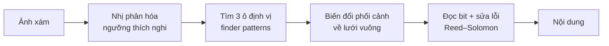
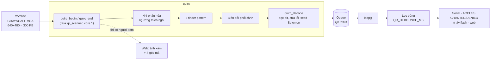
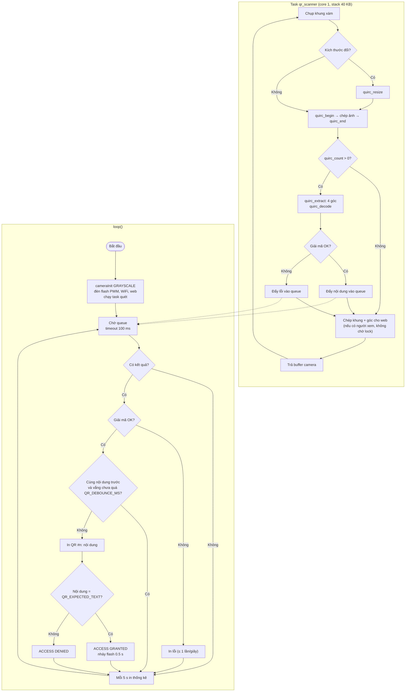

# #5 Đọc mã QR

> **Độ khó:** ⭐⭐⭐ · **Framework:** Arduino core 2.0.17 · **Env:** `05_qr_reader` · **Trạng thái:** 🟨 Đã có code, chưa thử trên board

Giải mã QR code trực tiếp trên ESP32-CAM bằng [quirc](https://github.com/dlbeer/quirc), lấy từ thư viện `ESP32QRCodeReader`.

## Mục tiêu

- Dùng thư viện ngoài qua `lib_deps` của PlatformIO.
- Hiểu vì sao chất lượng ảnh (nét, sáng, tương phản) quyết định kết quả nhiều hơn thuật toán.
- Đọc QR ổn định, rồi làm một ứng dụng nhỏ với nội dung đọc được (ví dụ: mở cửa giả lập, ghi log).

## Kiến thức cần biết

### Cách quirc đọc QR



- Chỉ cần **ảnh xám**: chụp `PIXFORMAT_GRAYSCALE`, không cần JPEG.
- Mỗi module (ô vuông nhỏ) của QR nên chiếm **ít nhất 2–3 pixel** trên ảnh. QR càng nhiều ký tự thì càng nhiều module, nên phải đưa lại gần hơn.
- **Mức sửa lỗi** (L/M/Q/H) càng cao thì càng chịu được ảnh xấu, nhưng QR sẽ dày đặc hơn.

### Vì sao khó hơn tưởng tượng

| Yếu tố | Ảnh hưởng |
|---|---|
| Lấy nét | Ống kính OV2640 lấy nét cố định ở xa; QR ở gần bị mờ. Có thể vặn ống kính để chỉnh nét (phải cạy lớp keo, có rủi ro) |
| Ánh sáng | Thiếu sáng thì nhiễu; đèn flash chiếu thẳng thì bị lóa trên giấy bóng |
| Rung, nhòe | Phơi sáng lâu khi thiếu sáng làm ảnh bị nhòe |
| Độ phân giải | Cao thì đọc được từ xa hơn nhưng chậm hơn và tốn RAM hơn |

### QR cần bao nhiêu pixel?

Ống kính OV2640 thường có góc nhìn ngang khoảng 60°, nên ở khoảng cách `d`, khung hình rộng khoảng `1.15·d`. Với QR khổ `S` có `N` module (tính cả 8 module viền trắng):

```
pixel/module ≈ (S / N) · (W / (1.15·d))        W = chiều ngang ảnh (pixel)
```

Ví dụ: QR ngắn, ECC L (version 1, 21 + 8 = 29 module), khổ 4 cm, đặt cách 30 cm:

| Ảnh | Pixel/module | Đọc được? |
|---|---|---|
| QVGA 320 px | (4/29) · (320/34.5) ≈ 1.3 | Khó, dưới 2 px/module |
| VGA 640 px | ≈ 2.6 | Được |
| SVGA 800 px | ≈ 3.2 | Tốt, nhưng chậm hơn |

Vì vậy bài này mặc định dùng **VGA**. QR dài hơn (version cao, nhiều module hơn) cần đưa lại gần hoặc in to hơn.

## Pipeline và lưu đồ giải thuật

### Pipeline xử lý



### Lưu đồ giải thuật

Hai luồng chạy song song: task quét (`scanner.cpp`) và `loop()` (`main.cpp`).



## Thiết kế

```
05_qr_reader/
├── README.md
└── src/
    ├── lesson_config.h   # Độ phân giải, tương phản, đèn flash, debounce, nội dung "mở cửa"
    ├── main.cpp          # Khởi tạo, nhận kết quả, lọc trùng, ứng dụng mẫu
    ├── scanner.h/.cpp    # Task quét: camera → quirc → queue
    └── web.h/.cpp        # Trang web: ảnh xám + khung mã, nội dung, đổi độ phân giải/đèn/tương phản

tools/qr_test_sheet.py    # Tạo trang QR thử để in
```

`platformio.ini`:

```ini
[env:05_qr_reader]
build_src_filter = +<05_qr_reader/src/>
lib_deps = alvarowolfx/ESP32QRCodeReader@1.1.0
```

### Vì sao không dùng lớp `ESP32QRCodeReader`?

Đọc mã nguồn thư viện (`src/ESP32QRCodeReader.cpp`) thì lớp này:

- Tự gọi `esp_camera_init()` với XCLK 10 MHz, `fb_count = 1`, nên xung đột với `common/esp32cam/camera_init`.
- Nghỉ 100 ms sau mỗi khung và không cho lấy ảnh ra ngoài, nên không xem được ảnh để chỉnh nét. Trong khi đó, lấy nét là phần khó nhất của bài này.
- Bên trong chỉ là một vòng lặp gọi **quirc**.

Vì vậy bài này vẫn dùng thư viện qua `lib_deps`, nhưng gọi thẳng quirc đi kèm (`#include "quirc/quirc.h"`), và tự viết task quét giống task của thư viện nhưng có thêm:

- dùng camera chung,
- đổi độ phân giải lúc chạy,
- đo thời gian từng bước,
- lấy 4 góc mã để vẽ trên web.

### Các điểm chính

- **Stack 40 KB:** `quirc_decode` khai báo trên stack hai mảng `QUIRC_MAX_PAYLOAD` (8896 byte), tổng khoảng 18 KB. Task mặc định của Arduino (8 KB) sẽ bị tràn stack, nên quét trong task riêng như thư viện làm. Còn `quirc_code` (~4 KB) và `quirc_data` (~9 KB) được khai báo `static`.
- **Đổi độ phân giải lúc chạy:** với ảnh xám (và mọi ảnh thô), driver cố định cỡ khung lúc khởi tạo. Cấp buffer lớn rồi `set_framesize()` nhỏ hơn như với JPEG thì mọi khung bị báo `FB-SIZE: ... != ...` và bị bỏ. Vì vậy, khi web yêu cầu đổi cỡ, task quét tự gọi `esp_camera_deinit()` rồi `cameraInit()` lại (khoảng nửa giây), sau đó gọi `quirc_resize`. Chỉ task quét được chạm vào camera (đổi cỡ, tương phản), để web không gọi sensor đúng lúc camera đang khởi tạo lại.
- **XCLK 10 MHz:** ảnh xám VGA/SVGA ở 20 MHz đổ dữ liệu nhanh hơn tốc độ DMA chép vào PSRAM, log báo `EV-VSYNC-OVF` và mất khung. Ví dụ của thư viện cũng dùng 10 MHz.
- **Web không làm chậm việc quét:** task quét chỉ chép khung khi có trình duyệt xin ảnh trong 2 giây gần nhất. Nó dùng `xSemaphoreTake(lock, 0)`, nên nếu web đang nén khung trước thì bỏ qua, không phải chờ.
- **Lọc trùng:** giữ QR trước camera thì chỉ báo một lần. Muốn báo lại, phải đưa mã ra khỏi khung quá `QR_DEBOUNCE_MS`.

### Cấu hình (`src/lesson_config.h`)

| Tham số | Mặc định | Sửa trên web | Ý nghĩa |
|---|---|:-:|---|
| `QR_FRAME_SIZE` | `FRAMESIZE_VGA` | ✅ | Độ phân giải lúc khởi động (QVGA, CIF, VGA, SVGA) |
| `QR_MAX_FRAME_SIZE` | `FRAMESIZE_SVGA` | | Cỡ lớn nhất được đổi lên trên web, quyết định buffer web cấp sẵn |
| `QR_XCLK_HZ` | `10000000` | | Xung nhịp camera; 20 MHz làm mất khung ở ảnh xám lớn |
| `QR_CONTRAST` | `1` | ✅ | Tương phản cảm biến (-2..2) |
| `QR_FLASH_DUTY` | `0` | ✅ | Độ sáng đèn flash khi quét (0–255) |
| `QR_DEBOUNCE_MS` | `3000` | | Thời gian vắng mã trước khi báo lại cùng nội dung |
| `QR_EXPECTED_TEXT` | `"ESP32-CAM-OPEN"` | | Nội dung "mở cửa"; `""` để tắt ứng dụng mẫu |
| `QR_ACTION_LED` | `1` | | Nháy flash 0.5 s khi mở cửa |
| `QR_WEB` | `1` | | Bật WiFi + trang web |
| `QR_TASK_STACK` | `40 KB` | | Stack của task quét |

## Chạy

```powershell
& "$env:USERPROFILE\.platformio\penv\Scripts\pio.exe" run -e 05_qr_reader -t upload --upload-port COM5
& "$env:USERPROFILE\.platformio\penv\Scripts\pio.exe" device monitor -e 05_qr_reader --port COM5
```

Tạo và in bộ QR thử (in tỉ lệ 100%, kiểm tra khổ bằng thước):

```powershell
pip install segno
python tools/qr_test_sheet.py
```

Log mong đợi:

```
Web: http://192.168.x.x
QR reader ready: 640x480, flash 0, debounce 3000 ms, expected "ESP32-CAM-OPEN"
Scanner: 640x480 grayscale
640x480 4.0 fps | identify 180 ms, decode 0.0 ms | frames with code 0, decoded 0, failed 0
QR #1: "HELLO-ESP32" (11 chars, version 1, ECC L, decode 6.2 ms)
ACCESS DENIED
QR #2: "ESP32-CAM-OPEN" (14 chars, version 1, ECC M, decode 5.8 ms)
ACCESS GRANTED
QR found but decode failed: ECC failure
```

(Các số ms ở trên chỉ minh họa định dạng, chưa phải số đo.)

Trên web (`http://<ip>`):

- Ảnh xám, mã tìm thấy được viền xanh lá theo 4 góc.
- Nội dung vừa đọc (xanh lá: mở cửa, đỏ: từ chối) và lịch sử 10 lần gần nhất.
- Đổi độ phân giải, đèn flash, tương phản.

> [!TIP]
> Nhìn ảnh trên web để biết lỗi nằm ở đâu:
> - Thấy viền xanh nhưng báo `decode failed`: tìm được mã nhưng ảnh mờ hoặc lóa. Chỉnh khoảng cách, ánh sáng.
> - Không có viền: không tìm thấy 3 ô định vị. QR quá nhỏ, quá mờ, hoặc thiếu viền trắng.

### Kịch bản test

| # | Bước | Mong đợi |
|:-:|---|---|
| T1 | Đưa QR "mở cửa" (4 cm) cách 20 cm | `QR #n: "ESP32-CAM-OPEN"`, `ACCESS GRANTED`, flash nháy |
| T2 | Giữ nguyên QR trước camera 10 s | Chỉ báo 1 lần (lọc trùng) |
| T3 | Đưa ra rồi vào lại sau > 3 s | Báo lại |
| T4 | Mỗi QR trong bộ thử: tìm khoảng cách gần nhất / xa nhất đọc được | Điền bảng Kết quả |
| T5 | Đọc QR 4 cm ở 10, 20, 30 cm, mỗi lần 10 lượt | ≥ 8/10 lượt đọc được trong 2 s (tiêu chí) |
| T6 | Lặp T5 với QVGA và SVGA | So sánh fps và khoảng cách |
| T7 | Đèn flash 0, 20, 60, 255 với giấy thường và giấy bóng | Ghi mức đèn tốt nhất |

## Các bước thực hiện

- [x] Thêm env và `lib_deps`, đọc mã nguồn thư viện; dùng quirc đi kèm với task quét tự viết
- [x] In nội dung QR ra Serial
- [x] Tạo bộ QR thử: ngắn (11 ký tự) và dài (100 ký tự), mức sửa lỗi L và H, 3 kích thước (2, 4, 6 cm): `tools/qr_test_sheet.py`
- [ ] In bộ QR thử
- [ ] Đo khoảng cách đọc được với từng loại
- [ ] Thử đèn flash ở vài mức độ sáng
- [ ] (Tùy chọn) Thử QVGA so với VGA: tốc độ và khoảng cách
- [x] Thêm debounce, sau đó làm ứng dụng nhỏ (QR đúng nội dung thì nháy LED)
- [x] Trang web xem ảnh xám + khung mã, đổi độ phân giải / đèn / tương phản lúc chạy

## Tiêu chí hoàn thành

- Đọc được QR khổ khoảng 4 cm ở khoảng cách **10–30 cm** dưới ánh sáng phòng.
- Đọc thành công ≥ 8/10 lần, mỗi lần trong vòng 2 giây.

## Kết quả

Build: ✅ RAM 21.9% (72 KB), Flash 27.9% (878 KB / 3 MB). Task quét cấp thêm 40 KB stack lúc chạy.

| QR | Mức sửa lỗi | Khổ | Khoảng cách đọc được | Thời gian giải mã |
|---|---|---|---|---|
| 11 ký tự | L | 4 cm | _chưa đo_ | _chưa đo_ |
| 11 ký tự | H | 4 cm | _chưa đo_ | _chưa đo_ |
| 100 ký tự | L | 4 cm | _chưa đo_ | _chưa đo_ |
| 100 ký tự | L | 6 cm | _chưa đo_ | _chưa đo_ |

## Khó khăn thường gặp

| Vấn đề | Gợi ý |
|---|---|
| Không bao giờ đọc được | In ảnh xám ra web để xem; thường do mờ hoặc QR quá nhỏ trên ảnh |
| Lúc đọc được, lúc không | Ánh sáng không đều; bật đèn flash nhẹ, tránh lóa |
| Camera init failed | Thư viện và code của mình cùng khởi tạo camera; bài này không dùng lớp `ESP32QRCodeReader` nên không bị |
| Thấy viền xanh nhưng `decode failed` | Tìm được mã nhưng ảnh mờ/lóa: lùi ra một chút (ống kính nét ở xa), giảm đèn flash |
| Reset kèm `Stack canary watchpoint triggered (qr_scanner)` | Tăng `QR_TASK_STACK` |
| `FB-SIZE: 76800 != 480000` liên tục, web không có ảnh | Ảnh thô khởi tạo ở một cỡ rồi `set_framesize()` sang cỡ khác. Phải khởi tạo lại camera (repo đã sửa) |
| `EV-VSYNC-OVF`, fps thấp | XCLK quá cao với ảnh thô lớn; giữ `QR_XCLK_HZ 10000000` hoặc giảm độ phân giải |
| `quirc_resize ... failed` | Hết PSRAM khi đổi lên độ phân giải lớn; giảm `QR_MAX_FRAME_SIZE` |
| Chậm ở VGA | Quay về QVGA, đưa QR lại gần |

## Tham khảo

- [alvarowolfx/ESP32QRCodeReader](https://github.com/alvarowolfx/ESP32QRCodeReader)
- [dlbeer/quirc](https://github.com/dlbeer/quirc)
- [QR code – Wikipedia](https://en.wikipedia.org/wiki/QR_code): cấu trúc, finder pattern, mức sửa lỗi

---

⬅️ [#4 Bám màu](../04_color_tracking/README.md) · ➡️ [#6 Phát hiện có người](../06_person_detection/README.md)
