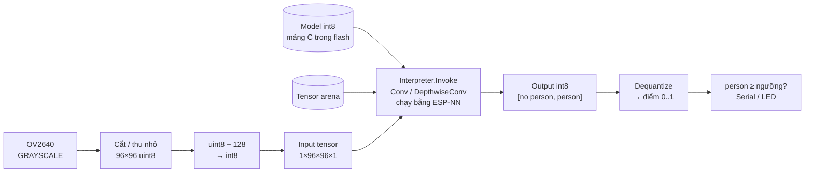
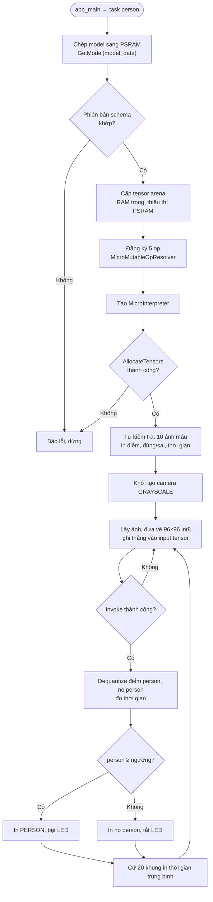

# #6 Phát hiện có người

> **Độ khó:** ⭐⭐⭐ · **Framework:** ESP-IDF 6.1 · **Project:** độc lập (build bằng `idf.py` trong thư mục này, không dùng env ở gốc) · **Trạng thái:** 🟨 Đang làm

Chạy mô hình TinyML có sẵn để trả lời câu hỏi **"trong ảnh có người hay không?"**, dựa trên ví dụ `person_detection` của [esp-tflite-micro](https://github.com/espressif/esp-tflite-micro).

## Mục tiêu

- Chuyển từ Arduino sang **ESP-IDF**: `idf.py`, `menuconfig`, `sdkconfig`, component manager.
- Hiểu cách TensorFlow Lite Micro chạy một mô hình: model dạng mảng C, tensor arena, interpreter.
- Tiền xử lý ảnh camera cho đúng đầu vào của mô hình.
- Đo tác dụng của **ESP-NN** (các hàm tính toán tối ưu cho ESP32).

## Kiến thức cần biết

### Mô hình

| Thuộc tính | Giá trị |
|---|---|
| Kiến trúc | MobileNet thu nhỏ, đã lượng tử hóa int8 |
| Kích thước | 300 568 byte (`person_detect_model_data.cc`, mảng C trong flash) |
| Đầu vào | Ảnh **96×96, 1 kênh xám**, int8 |
| Đầu ra | 2 điểm số: `no person` (chỉ số 0), `person` (chỉ số 1), qua softmax |
| Op cần dùng | `AveragePool2D`, `Conv2D`, `DepthwiseConv2D`, `Reshape`, `Softmax` |
| Dữ liệu train | Visual Wake Words (dựa trên COCO) |

### Thành phần của TFLite Micro

- **Tensor arena:** vùng RAM cố định cấp phát một lần, chứa toàn bộ tensor trung gian. Thiếu thì `AllocateTensors()` báo lỗi.
- **Op resolver:** chỉ đăng ký các phép toán mà mô hình cần (Conv2D, DepthwiseConv2D...) để giảm kích thước firmware.
- **ESP-NN:** khi bật, các phép như Conv2D chạy bằng code tối ưu cho ESP32 thay vì code C chung.

### Lượng tử hóa đầu vào / đầu ra

Model int8 có `zero_point = -128` ở đầu vào, nên điểm ảnh `uint8` (0..255) đổi sang `int8` bằng cách trừ 128. Phép này giống hệt việc **đảo bit cao** (`v ^ 0x80`), nên code dùng phép XOR.

Đầu ra cũng là int8. Muốn ra điểm 0..1 thì phải *dequantize*:

```
điểm = (q − zero_point) × scale
```

`scale` và `zero_point` đọc từ `output->params`, không viết cứng.

### Vì sao dùng ESP-IDF?

esp-tflite-micro được phát hành như một component của ESP-IDF qua Component Manager. Có thể chạy trên Arduino, nhưng ESP-IDF là con đường chính thức và dễ bật ESP-NN. Máy đã cài ESP-IDF **v6.1** bằng EIM: framework ở `C:\esp\v6.1\esp-idf`, công cụ ở `C:\Espressif\tools`.

> [!NOTE]
> Trên ESP32 thường (bài này), ESP-NN dùng bản tối ưu *generic* bằng C. Bản viết bằng assembly SIMD chỉ có trên ESP32-S3 (và PIE trên ESP32-P4). Vì vậy mức tăng tốc trên ESP32-CAM sẽ thấp hơn các số Espressif công bố cho S3.

## Pipeline và lưu đồ giải thuật

### Pipeline xử lý



### Lưu đồ giải thuật



## Thiết kế

```
06_person_detection/
├── README.md
├── CMakeLists.txt
├── sdkconfig.defaults           # PSRAM, CPU 240 MHz, -O2, flash 4 MB, ESP-NN bật
├── sdkconfig.ansi_c             # Ghép thêm để build bản KHÔNG có ESP-NN
├── dependencies.lock            # Phiên bản component đã chốt (commit cùng code)
└── main/
    ├── CMakeLists.txt           # Nhúng 10 ảnh mẫu bằng EMBED_FILES, include common/
    ├── idf_component.yml        # esp-tflite-micro ^1.4.1 (kéo theo esp-nn), esp32-camera ^2.1.8
    ├── lesson_config.h          # Ảnh, ngưỡng, LED, tensor arena, log
    ├── model_settings.h         # 96×96×1, chỉ số lớp
    ├── main.cc                  # Model, interpreter, tự kiểm tra, vòng lặp + thống kê
    ├── image_provider.h/.cc     # Camera xám → 96×96 int8 (cắt giữa + trung bình nếu khung lớn hơn)
    ├── detection_responder.h/.cc  # So ngưỡng, in kết quả, LED đỏ GPIO33
    ├── snapshot.h/.cc           # Lệnh 'c' qua Serial → in ảnh 96×96 model thấy (hex)
    ├── person_detect_model_data.h/.cc  # Model 300 KB dạng mảng C (từ ví dụ gốc)
    ├── sample_images/           # 10 ảnh xám 96×96 thô (từ ví dụ gốc)
    └── LICENSE.tflite-micro     # Apache-2.0 của ví dụ gốc
```

Sơ đồ chân camera dùng lại `common/camera_pins.h` của các bài Arduino (thêm `../../../common` vào include của component `main`).

### Khác với ví dụ gốc

| Ví dụ gốc | Bài này | Lý do |
|---|---|---|
| Sơ đồ chân ESP-EYE / chọn trong menuconfig | AI-Thinker từ `common/camera_pins.h` | Dùng chung với các bài trước |
| Chỉ nhận đúng khung 96×96 | Khung lớn hơn: cắt vuông ở giữa + trung bình theo ô | Thử được QQVGA/QVGA, không méo tỉ lệ |
| Tensor arena ưu tiên PSRAM, model đọc thẳng từ flash | Arena 88 KB trong RAM trong, model chép sang PSRAM; in nơi cấp và số byte dùng thật | Nhanh hơn (đo ở mục Kết quả) |
| Ảnh mẫu chỉ chạy qua lệnh CLI | Tự chạy 10 ảnh mẫu lúc khởi động, in đúng/sai và thời gian | Kiểm tra model không cần camera; đo ESP-NN trên cùng dữ liệu |
| In mỗi khung, không đo tiền xử lý | Thống kê mỗi 20 khung: chụp / tiền xử lý / suy luận / FPS | Điền bảng Kết quả |
| Không có LED | LED đỏ GPIO33 (mức thấp là sáng) | Thấy kết quả không cần Serial |
| Không xem được ảnh | Lệnh `c` qua Serial trả về ảnh 96×96 đầu vào model kèm kết luận, `tools/person_snapshot.py` lưu PNG có ghi kết quả | Biết model đang thấy gì, không cần WiFi |
| Bảng phân vùng OTA tự viết | `PARTITION_TABLE_SINGLE_APP_LARGE` có sẵn của IDF | Không cần OTA, app 1.5 MB là đủ |

### Cấu hình (`main/lesson_config.h`)

| Tham số | Mặc định | Ý nghĩa |
|---|---|---|
| `PD_FRAME_SIZE` | `FRAMESIZE_96X96` | Cỡ khung camera. `96X96`: cảm biến tự thu nhỏ. `QQVGA`/`QVGA`: phần mềm cắt giữa rồi thu nhỏ |
| `PD_XCLK_HZ` | `15000000` | Xung nhịp camera (như ví dụ gốc) |
| `PD_VFLIP`, `PD_HMIRROR` | `0` | Lật ảnh. Model được train với người đứng thẳng, nên ảnh lộn ngược sẽ cho kết quả kém |
| `PD_THRESHOLD` | `0.60` | Báo PERSON khi điểm person ≥ ngưỡng |
| `PD_LED_GPIO` | `33` | LED đỏ trên board; `-1` để tắt |
| `PD_ARENA_SIZE` | `88 KB` | Kích thước tensor arena (dùng thật 82 300 byte; phải < khối RAM trong liền lớn nhất ~108 KB) |
| `PD_ARENA_PREFER_INTERNAL` | `1` | Thử RAM trong trước, không đủ mới dùng PSRAM |
| `PD_MODEL_IN_PSRAM` | `1` | Chép model 300 KB từ flash sang PSRAM lúc khởi động (suy luận nhanh hơn ~8%) |
| `PD_PRINT_EVERY_FRAME` | `1` | `0`: chỉ in khi kết quả đổi |
| `PD_STATS_EVERY` | `20` | Số khung mỗi lần in thống kê |
| `PD_SELF_TEST` | `1` | Chạy 10 ảnh mẫu lúc khởi động |
| `PD_SNAPSHOT` | `1` | Nhận lệnh `c` qua Serial, in ảnh đầu vào model (xem mục 5) |

## Chạy

### 1. Mở terminal ESP-IDF

Dùng shortcut **ESP-IDF 6.1 PowerShell** do EIM tạo, hoặc trong PowerShell thường:

```powershell
. C:\Espressif\tools\Microsoft.v6.1.PowerShell_profile.ps1
idf.py --version          # ESP-IDF v6.1
cd projects\06_person_detection
```

> [!TIP]
> Lần đầu `idf.py` có thể đứng vài chục giây ở bước `git describe --dirty` vì git phải quét lại index của repo ESP-IDF. Các lần sau chỉ mất vài giây.

### 2. Build, nạp, xem log (có ESP-NN)

```powershell
idf.py -B C:\esp-build\06 build                     # lần đầu: tạo sdkconfig, tải component, ~1300 file
idf.py -B C:\esp-build\06 -p COM5 flash monitor     # Ctrl+] để thoát monitor
```

> [!IMPORTANT]
> **Phải dùng thư mục build ngắn (`-B C:\esp-build\06`).** Repo nằm sâu trong `Documents\PlatformIO\Projects\...`, nên `build/` mặc định làm đường dẫn file object của TFLite Micro dài hơn 250 ký tự. GCC trên Windows sẽ báo `fatal error: opening dependency file ... .obj.d: No such file or directory`. `sdkconfig` vẫn nằm trong thư mục bài (đã gitignore). Target mặc định đã là `esp32`, nên không cần `set-target`.

Nạp bằng đế ESP32-CAM-MB thì nó tự đưa board vào chế độ nạp. Nếu dùng USB-TTL thì phải nối GPIO0 xuống GND khi nạp.

### 3. Đo khi không có ESP-NN

Build vào thư mục riêng, để hai bản không ghi đè `sdkconfig` của nhau:

```powershell
idf.py -B C:\esp-build\06_ansi -D SDKCONFIG=C:/esp-build/06_ansi/sdkconfig -D "SDKCONFIG_DEFAULTS=sdkconfig.defaults;sdkconfig.ansi_c" build
idf.py -B C:\esp-build\06_ansi -D SDKCONFIG=C:/esp-build/06_ansi/sdkconfig -p COM5 flash monitor
```

Dòng `Kernels: ...` trong log cho biết bản đang chạy: `ESP-NN` hay `ANSI C (no ESP-NN)`. Cũng có thể đổi tay trong `idf.py menuconfig` → *Component config* → *ESP-NN* → *Optimization for nn functions*.

### Log mong đợi

```
Model: 300568 bytes in PSRAM, input 96x96x1 int8, output 2 classes
Tensor arena: 90112 bytes in internal RAM, used 82300 bytes (largest free internal block 110592)
Kernels: ESP-NN

--- Self test: 10 sample images, ESP-NN ---
image0 person           person  95%  -> PERSON    OK    542 ms
image1 dog              person  35%  -> no person OK    542 ms
...
Self test: 8/10 correct, invoke avg 542 ms (min 542, max 542)

Person detection ready: threshold 0.60, free internal 241568, PSRAM 3871624
PERSON    person  95%  no person   5%
[stats] 20 frames: capture 9.0 ms, preprocess 1.34 ms, invoke 555.5 ms (ESP-NN), 1.76 FPS, person 20/20
```

(Log thật trên ESP32-CAM AI-Thinker, ngày 26/10/2026.)

### 4. Đo độ chính xác trên cảnh thật

Đóng `idf.py monitor`, rồi chạy (Python trong venv của ESP-IDF đã có pyserial):

```powershell
C:\Espressif\tools\python\v6.1\venv\Scripts\python.exe ..\..\tools\person_eval.py COM5 --csv person_eval.csv
```

Script hỏi lần lượt 20 cảnh có người rồi 20 cảnh không người. Mỗi cảnh: đặt camera, nhấn Enter, script lấy trung vị điểm `person` của 3 khung. Cuối cùng in độ chính xác, số bỏ sót / báo nhầm ở các ngưỡng 0.5–0.9, nên làm luôn được T7 mà không phải nạp lại. Tính lại từ file đã lưu: `person_eval.py --from-csv person_eval.csv`.

### 5. Xem ảnh model đang thấy

Đóng `idf.py monitor`, rồi chạy:

```powershell
C:\Espressif\tools\python\v6.1\venv\Scripts\python.exe ..\..\tools\person_snapshot.py COM5
```

Script gửi ký tự `c`, firmware giữ lại ảnh 96×96 của khung kế tiếp (đúng ảnh đưa vào model, sau khi đã cắt/thu nhỏ), in ra 96 dòng hex kèm điểm `person`, script lưu thành `snapshots/snap_<giờ>_person<điểm>.png` (phóng to 4 lần) rồi mở ra xem. Ảnh có viền và dải chữ ghi kết quả: xanh `PERSON 94%` khi điểm person ≥ `PD_THRESHOLD`, xám `NO PERSON 88%` khi không (số là điểm của chính kết luận đó). Chụp nhiều ảnh: `--count 10 --interval 2 --no-show`; chỉ lấy ảnh gốc: `--no-label`.

Mỗi ảnh mất ~2–3 s: chờ tối đa một lần suy luận (~0.55 s) rồi gửi 18 KB hex ở 115200 baud (~1.6 s). Thời gian gửi không tính vào FPS của dòng `[stats]`. Không dùng WiFi nên không ảnh hưởng RAM trong của tensor arena (bộ đệm ảnh 9 KB nằm trong PSRAM).

Dùng khi: kiểm tra hướng ảnh (`PD_VFLIP`/`PD_HMIRROR`), độ sáng, người có chiếm đủ khung không, và xem lại các cảnh mà `person_eval.py` đoán sai.

### Kịch bản test

| # | Bước | Mong đợi |
|:-:|---|---|
| T1 | Khởi động, xem phần tự kiểm tra | 10 ảnh đều chạy được; ghi số đúng và `invoke avg` |
| T2 | Hướng camera vào tường trống | `no person`, LED tắt |
| T3 | Đứng cách 1–2 m, người chiếm phần lớn khung | `PERSON`, LED đỏ sáng |
| T4 | Ghi dòng `[stats]` sau vài lần | Điền thời gian chụp / tiền xử lý / suy luận |
| T5 | Build bản `06_ansi`, lặp T1 và T4 | Điền cột "không có ESP-NN" |
| T6 | 20 cảnh có người và 20 cảnh không người (`tools/person_eval.py`) | Tính độ chính xác |
| T7 | Xem bảng ngưỡng 0.5–0.9 do `person_eval.py` in ra | Đánh đổi giữa báo nhầm và bỏ sót |
| T8 | Đổi `PD_FRAME_SIZE` sang `FRAMESIZE_QVGA` | So sánh góc nhìn, thời gian tiền xử lý |

## Các bước thực hiện

- [x] Kiểm tra `idf.py --version` (ESP-IDF v6.1)
- [x] Tạo project từ ví dụ (`idf.py create-project-from-example "espressif/esp-tflite-micro:person_detection"`), viết lại gọn theo cấu trúc repo
- [x] `idf.py set-target esp32`, sơ đồ chân AI-Thinker lấy từ `common/camera_pins.h`
- [x] `sdkconfig.defaults`: PSRAM, 240 MHz, `-O2`, flash 4 MB, ESP-NN
- [x] Build thành công bản có ESP-NN
- [x] Build bản không có ESP-NN (`sdkconfig.ansi_c`)
- [x] Nạp, xem điểm person / no person
- [x] Sửa arena rơi sang PSRAM (160 KB → 88 KB) và task watchdog trong lúc tự kiểm tra
- [x] Đo thời gian suy luận **khi có ESP-NN**
- [x] Đo thời gian suy luận **khi không có ESP-NN** (`06_ansi`)
- [x] Thử đặt model trong PSRAM thay vì flash
- [ ] Thử 20 cảnh có người và 20 cảnh không có người, tính độ chính xác
- [ ] (Tùy chọn) Đổi ngưỡng quyết định, xem đánh đổi giữa báo nhầm và bỏ sót

## Tiêu chí hoàn thành

- In ra điểm `person` / `no person` theo thời gian thực.
- Có bảng so sánh thời gian suy luận khi bật và tắt ESP-NN.

## Kết quả

Đo trên ESP32-CAM AI-Thinker (ESP32-D0WD, PSRAM 8 MB, ánh xạ được 4 MB), CPU 240 MHz, `-O2`, flash DIO 40 MHz, ngày 26/10/2026.

| Hạng mục | Giá trị |
|---|---|
| Phiên bản ESP-IDF / esp-tflite-micro / esp-nn / esp32-camera | v6.1.0 / 1.4.1 / 1.4.1 / 2.1.8 |
| Firmware có / không ESP-NN | 748 992 / 743 408 byte (51% / 52% phân vùng app 1.5 MB còn trống) |
| Kích thước model / tensor arena | 300 568 byte / cấp 88 KB, dùng 82 300 byte (như nhau ở hai bản) |
| Tự kiểm tra 10 ảnh mẫu | 8/10 đúng ở cả hai bản: sai `monkey` (person 76% → báo nhầm) và `portrait` (12% → bỏ sót) |
| Thời gian chụp + tiền xử lý | 9.0 ms + 1.3 ms (khung 96×96 do cảm biến thu nhỏ) |
| FPS | 1.76 (có ESP-NN) / 1.39 (không ESP-NN) |
| Độ chính xác (40 cảnh thử) | _chưa đo_, chạy `tools/person_eval.py` (mục 4) |

### Thời gian suy luận

Một lần `Invoke()`, lấy từ phần tự kiểm tra (10 ảnh, min = max) và dòng `[stats]` khi chạy camera:

| Cấu hình | Có ESP-NN | Không ESP-NN | Tăng tốc |
|---|---:|---:|---:|
| Arena 160 KB (rơi sang **PSRAM**), model trong flash | 676 ms | — | |
| Arena 88 KB trong **RAM trong**, model trong flash | 588 ms | 735 ms | 1.25× |
| Arena trong RAM trong, model chép sang **PSRAM** (mặc định) | **542 ms** | **687 ms** | **1.27×** |
| Cùng cấu hình mặc định, đo trong vòng camera (`[stats]`) | 555 ms | 703 ms | 1.27× |

Nhận xét:

- **ESP-NN chỉ nhanh hơn ~1.27 lần** trên ESP32 thường. Trên ESP32 thường, ESP-NN chỉ có bản C tổng quát (tối ưu vòng lặp, không có lệnh SIMD); bản assembly chỉ có cho ESP32-S3, nên con số tăng tốc lớn mà Espressif công bố là của S3.
- **Nơi đặt tensor arena ảnh hưởng nhiều hơn**: arena trong PSRAM chậm hơn RAM trong ~15% (676 → 588 ms). Arena 160 KB cấp từ đầu không vừa khối RAM trong liền lớn nhất (110 592 byte) nên bị đưa sang PSRAM; giảm còn 88 KB (dùng thật 82 300 + ~8 KB dự phòng) là đủ vào RAM trong.
- **Model trong PSRAM nhanh hơn trong flash ~8%** (588 → 542 ms): mỗi lần suy luận đọc lại toàn bộ 300 KB trọng số, PSRAM QIO 40 MHz đọc nhanh hơn flash DIO 40 MHz. Mức lợi nhỏ cho thấy phần lớn thời gian là tính toán, không phải đọc bộ nhớ. Đổi giá: tốn 300 KB PSRAM.
- Chụp và tiền xử lý (~10 ms) không đáng kể so với suy luận (~550 ms); FPS gần như do model quyết định.
- Hai ảnh mẫu sai giống hệt nhau ở cả hai bản, đúng như mong đợi: ESP-NN và kernel C tham chiếu cho cùng kết quả số học, chỉ khác tốc độ.

### Lỗi đã gặp khi chạy lần đầu

- **Task watchdog** (`task_wdt: IDLE0 (CPU 0)`) trong lúc tự kiểm tra: 10 lần suy luận liên tiếp (~7 s) không nhường CPU nên IDLE task không chạy được. Sửa: thêm `vTaskDelay(1)` sau mỗi ảnh mẫu.
- **Arena rơi sang PSRAM** như ở trên. Log giờ in thêm `largest free internal block` để biết giới hạn khi chỉnh `PD_ARENA_SIZE`.

## Khó khăn thường gặp

| Vấn đề | Gợi ý |
|---|---|
| Không tìm thấy `idf.py` | Dùng *ESP-IDF 6.1 PowerShell* do EIM tạo, hoặc dot-source `C:\Espressif\tools\Microsoft.v6.1.PowerShell_profile.ps1` |
| `MSys/Mingw is no longer supported` | Không chạy `idf.py` trong Git Bash; dùng PowerShell |
| Build lần đầu rất lâu, máy đơ | TFLite Micro có khoảng 1300 file. Máy ít RAM thì giới hạn số job: `idf.py build -- -j4` hoặc đặt biến môi trường `CMAKE_BUILD_PARALLEL_LEVEL=4` |
| `opening dependency file ... .obj.d: No such file or directory` (kèm cảnh báo `object file directory ... has 193 characters`) | Đường dẫn object vượt 250 ký tự. Build bằng `-B C:\esp-build\06`, xóa thư mục `build/` trong bài |
| `Failed to resize buffer` / `AllocateTensors() failed` | Tăng `PD_ARENA_SIZE` |
| Log in `Tensor arena: ... in PSRAM` | `PD_ARENA_SIZE` lớn hơn `largest free internal block`; giảm xuống gần `used` + vài KB |
| `task_wdt: ... IDLE0 (CPU 0)` | Vòng lặp chạy nhiều lần `Invoke()` liền nhau phải có `vTaskDelay(1)` giữa các lần |
| Camera init failed | Kiểm tra `CAMERA_MODEL_AI_THINKER` trong `lesson_config.h`; nguồn 5V đủ dòng |
| Điểm số luôn gần nhau | Sai tiền xử lý: kiểm tra 96×96, xám, trừ 128 để ra int8 |
| Tự kiểm tra đúng nhưng camera sai nhiều | Ảnh bị lật (`PD_VFLIP`), quá tối, hoặc người quá nhỏ trong khung |
| Kết quả kém | Mô hình 96×96 chỉ đúng khi người chiếm phần lớn khung hình |
| Bản `06_ansi` vẫn in `Kernels: ESP-NN` | `sdkconfig` cũ còn giữ lựa chọn; xóa `C:\esp-build\06_ansi` rồi build lại |

## Tham khảo

- [espressif/esp-tflite-micro](https://github.com/espressif/esp-tflite-micro): ví dụ `person_detection`
- [espressif/esp-nn](https://github.com/espressif/esp-nn)
- [TensorFlow Lite for Microcontrollers](https://ai.google.dev/edge/litert/microcontrollers/overview)
- Bài báo *Visual Wake Words Dataset* (Chowdhery et al., 2019)
- [ESP-IDF Programming Guide](https://docs.espressif.com/projects/esp-idf/en/stable/esp32/)

---

⬅️ [#5 Đọc mã QR](../05_qr_reader/README.md) · ➡️ [#7 Phân loại ảnh](../07_image_classification/README.md)
