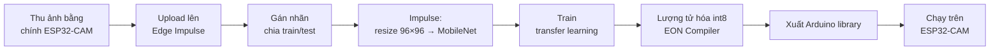
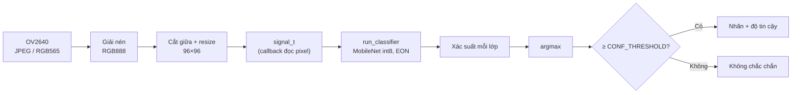
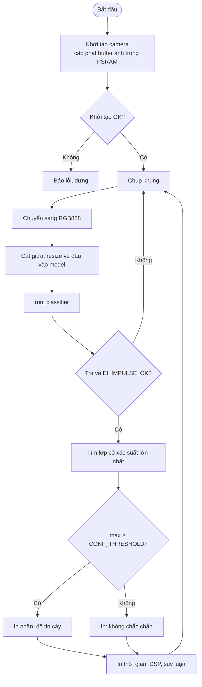

# #7 Phân loại ảnh tự huấn luyện

> **Độ khó:** ⭐⭐⭐⭐ · **Framework:** Arduino core 2.0.17 + Edge Impulse · **Env:** `07_image_classification` · **Trạng thái:** 🟨 Đang làm

Tự thu thập dữ liệu, train mô hình phân loại ảnh trên [Edge Impulse](https://edgeimpulse.com/) bằng transfer learning (MobileNet), rồi chạy mô hình trên ESP32-CAM.

## Mục tiêu

- Đi trọn một vòng **TinyML**: thu dữ liệu → gán nhãn → train → tối ưu → deploy → đánh giá thực tế.
- Hiểu **transfer learning**: tận dụng một mô hình đã học sẵn, chỉ train lại phần cuối.
- Chọn được kích thước đầu vào và mô hình sao cho vừa RAM/Flash mà vẫn đủ chính xác.

## Bài toán đề xuất

Chọn **3–4 lớp** dễ phân biệt, có ý nghĩa thực tế. Ví dụ:

| Ví dụ | Các lớp |
|---|---|
| Phân loại rác | `nhựa`, `giấy`, `kim loại`, `nền` |
| Nhận đồ vật trên bàn | `cốc`, `điện thoại`, `bút`, `nền` |
| Cử chỉ tay | `nắm tay`, `xòe tay`, `hai ngón`, `nền` |

> [!IMPORTANT]
> Luôn có lớp **`nền`** (không có gì). Nếu thiếu lớp này, mô hình buộc phải chọn một đồ vật ngay cả khi khung hình trống.

## Kiến thức cần biết

### Quy trình



- **Thu ảnh bằng chính ESP32-CAM:** màu sắc, độ nét và nhiễu của camera điện thoại khác hẳn OV2640, nên mô hình train bằng ảnh điện thoại thường chạy kém trên board.
- **Transfer learning:** MobileNetV1/V2 đã train trên ImageNet; chỉ thay và train lại các lớp cuối, nên cần ít dữ liệu (khoảng 50–100 ảnh/lớp là bắt đầu được).
- **Alpha (width multiplier):** 0.1, 0.25, 0.35... Alpha nhỏ thì mô hình nhỏ và nhanh nhưng kém chính xác hơn.
- **Lượng tử hóa int8:** giảm khoảng 4 lần kích thước so với float32, chạy nhanh hơn nhiều, độ chính xác giảm nhẹ.

### Lựa chọn đầu vào

| Đầu vào | Màu | RAM cần | Ghi chú |
|---|---|---|---|
| 96×96 | Xám | Thấp | Đủ cho hình dạng rõ ràng |
| 96×96 | RGB | Trung bình | Cần khi phân biệt bằng màu (phân loại rác) |
| 160×160 | RGB | Cao | Có thể không vừa, cần thử |

## Pipeline và lưu đồ giải thuật

### Pipeline xử lý trên board



### Lưu đồ giải thuật



## Thiết kế

```
07_image_classification/
├── README.md
├── capture/              # Firmware phụ để thu ảnh (env 07_capture)
│   ├── capture_config.h  # Độ phân giải, chất lượng JPEG, khóa phơi sáng, đèn flash
│   └── main.cpp          # Web xem trước + /capture.jpg + /flash
├── lib/                  # Arduino library xuất từ Edge Impulse (không commit nếu lớn)
└── src/
    ├── lesson_config.h   # Ngưỡng tin cậy, số lớp
    └── main.cpp          # Chụp → resize → run_classifier → in kết quả
tools/
└── capture_images.py     # Tải ảnh từ ESP32-CAM qua HTTP, lưu theo nhãn
dataset/                  # Ảnh đã thu: dataset/<nhãn>/<nhãn>.<giờ>_<số>.jpg (gitignore)
```

## Thu dữ liệu

### 1. Nạp firmware thu ảnh

```powershell
pio run -e 07_capture -t upload
pio device monitor -e 07_capture     # đọc dòng "Capture ready: http://<IP>"
```

WiFi lấy từ `common/secrets.h`. Không vào được mạng thì board tự phát WiFi `ESP32-CAM` (mật khẩu `12345678`), địa chỉ `http://192.168.4.1`: nối máy tính vào mạng đó để thu ảnh.

Mở `http://<IP>` để xem trước. Khung nét đứt là phần còn lại khi Edge Impulse cắt ảnh 4:3 về hình vuông (Resize mode *Fit shortest axis*): đặt vật trong khung. Thanh trượt chỉnh đèn flash; nếu bật đèn khi thu ảnh thì lúc chạy model cũng phải bật đúng độ sáng đó.

| Tham số (`capture/capture_config.h`) | Mặc định | Ý nghĩa |
|---|---|---|
| `CAP_FRAME_SIZE` | `FRAMESIZE_QVGA` | 320×240, ~10 KB/ảnh, dư cho đầu vào 96×96 hoặc 160×160 |
| `CAP_JPEG_QUALITY` | `10` | 0–63, càng nhỏ càng nét |
| `CAP_LOCK_EXPOSURE` | `0` | `1`: khóa cân bằng trắng / phơi sáng sau 2 s, mọi ảnh cùng màu. Để `0` nếu lúc chạy model camera vẫn tự chỉnh |
| `CAP_FLASH_DUTY` | `0` | Độ sáng đèn flash lúc khởi động |

### 2. Tải ảnh về theo nhãn

```powershell
python tools/capture_images.py 192.168.4.1 --label coc --count 80 --interval 1
python tools/capture_images.py 192.168.4.1 --label nen --count 80 --interval 1
python tools/capture_images.py 192.168.4.1 --label but --count 80 --manual   # Enter mỗi lần chụp
python tools/capture_images.py --summary                                     # đếm ảnh mỗi nhãn
```

Ảnh lưu ở `dataset/<nhãn>/<nhãn>.<giờ>_<số>.jpg`. Nhãn chỉ gồm chữ không dấu, số, `_`, `-`. Trong lúc chụp liên tục: xoay, dịch vật, đổi khoảng cách, đổi nền và ánh sáng. Lớp `nen` là cảnh trống ở đúng chỗ sẽ dùng.

### 3. Upload lên Edge Impulse

- Web: *Data acquisition* → *Upload data* → chọn thư mục `dataset/<nhãn>`, *Infer from filename*, *Automatically split between training and testing* (80/20).
- Hoặc CLI (cần Node.js, `npm install -g edge-impulse-cli`): `edge-impulse-uploader --category split dataset/*/*.jpg`

Edge Impulse lấy nhãn từ phần tên file trước dấu chấm đầu tiên.

## Các bước thực hiện

**Thu dữ liệu**
- [x] Viết firmware thu ảnh (env `07_capture`, endpoint `/capture.jpg`) và `tools/capture_images.py` để tải ảnh về theo nhãn
- [ ] Chọn 3–4 lớp + `nen`
- [ ] Thu ≥ 80 ảnh/lớp: đổi góc, khoảng cách, nền, ánh sáng
- [ ] Upload lên Edge Impulse, chia 80/20 train/test

**Train**
- [ ] Impulse: Image (96×96, chọn RGB hoặc Grayscale) → Transfer Learning (Images)
- [ ] Thử ít nhất 2 cấu hình (ví dụ MobileNetV1 0.25 và MobileNetV2 0.35), ghi lại độ chính xác, RAM, Flash, thời gian suy luận ước tính
- [ ] Xem confusion matrix, thu thêm ảnh cho lớp hay bị nhầm

**Deploy**
- [ ] Deployment → Arduino library, bật EON Compiler, chọn int8
- [ ] Thêm env `07_image_classification` với library vừa xuất
- [ ] Chạy ví dụ camera đi kèm library (sửa sang AI-Thinker), in kết quả ra Serial
- [ ] Đo thời gian chụp, tiền xử lý và suy luận

**Đánh giá**
- [ ] Thử thực tế 20 lần/lớp với đồ vật **không có** trong tập train
- [ ] So sánh độ chính xác thực tế với độ chính xác trên Edge Impulse

## Tiêu chí hoàn thành

- Phân loại ≥ 3 lớp (cộng lớp nền).
- Độ chính xác **thực tế** trên board ≥ 85%.
- Có bảng so sánh ít nhất 2 cấu hình mô hình.

## Kết quả

| Cấu hình | Đầu vào | Acc (EI test) | Acc (thực tế) | RAM | Flash | Suy luận |
|---|---|---|---|---|---|---|
| MobileNetV1 0.25 | 96×96 | _chưa đo_ | _chưa đo_ | | | |
| MobileNetV2 0.35 | 96×96 | _chưa đo_ | _chưa đo_ | | | |

| Hạng mục | Giá trị |
|---|---|
| Số ảnh mỗi lớp (train / test) | _chưa có_ |
| Link project Edge Impulse | _chưa có_ |

## Khó khăn thường gặp

| Vấn đề | Gợi ý |
|---|---|
| Trên EI chính xác 98%, trên board rất kém | Dữ liệu train không giống ảnh thật của board; thu ảnh bằng chính board, đúng vị trí sẽ dùng |
| Luôn ra cùng một lớp | Lệch dữ liệu (một lớp quá nhiều ảnh), hoặc sai định dạng đầu vào (RGB/xám) |
| Không đủ RAM khi chạy | Giảm alpha, dùng ảnh xám, bật EON, đặt buffer ảnh trong PSRAM |
| Board in `NO_AP_FOUND` rồi `starting AP 'ESP32-CAM'` | Sai SSID hoặc WiFi 5 GHz (ESP32 chỉ có 2.4 GHz); sửa `common/secrets.h`, hoặc nối máy vào WiFi `ESP32-CAM` |
| Build lâu / library rất lớn | Bình thường; không commit thư mục library, ghi link tải trong README |

## Tham khảo

- [Edge Impulse – Image classification](https://docs.edgeimpulse.com/docs/tutorials/end-to-end-tutorials/computer-vision/image-classification)
- [Edge Impulse – Arduino library deployment](https://docs.edgeimpulse.com/docs/run-inference/arduino-library)
- Bài báo *MobileNets* (Howard et al., 2017), *MobileNetV2* (Sandler et al., 2018)

---

⬅️ [#6 Phát hiện có người](../06_person_detection/README.md) · ➡️ [#8 Đếm vật thể (FOMO)](../08_fomo_object_counting/README.md)
