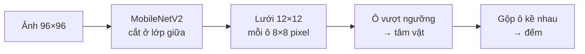
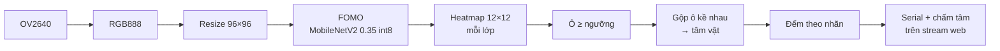
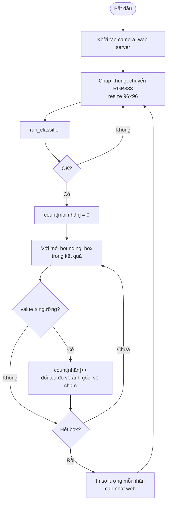

# #8 Phát hiện và đếm vật thể (FOMO)

> **Độ khó:** ⭐⭐⭐⭐ · **Framework:** Arduino core 2.0.17 + Edge Impulse · **Env:** `08_fomo_object_counting` · **Trạng thái:** ⬜ Chưa làm

Không chỉ trả lời "ảnh này là gì" như bài #7, mà còn trả lời **"có bao nhiêu vật, nằm ở đâu"**, bằng FOMO (*Faster Objects, More Objects*) của Edge Impulse.

## Mục tiêu

- Hiểu khác biệt giữa **classification**, **object detection** và cách FOMO đơn giản hóa detection.
- Gán nhãn bằng **bounding box**.
- Đếm vật thể trong khung hình và đánh giá bằng F1-score, sai số đếm.

## Bài toán đề xuất

| Ví dụ | Nhãn | Ghi chú |
|---|---|---|
| Đếm đồng xu trên bàn | `coin` | Dễ: nền đơn giản, vật giống nhau |
| Đếm viên kẹo theo màu | `red`, `green`, `yellow` | Nhiều lớp, cần ảnh màu |
| Đếm ốc vít / linh kiện | `screw`, `nut` | Vật nhỏ, cần camera gần |

Nên bắt đầu với **một lớp, nền trơn, camera cố định** từ trên xuống.

## Kiến thức cần biết

### FOMO khác gì object detection thông thường?

| | Detector thông thường (SSD, YOLO) | FOMO |
|---|---|---|
| Đầu ra | Bounding box (x, y, w, h) + lớp | **Lưới heatmap**: mỗi ô cho biết ô đó có tâm vật hay không |
| Kích thước vật | Có | Không (chỉ có vị trí tâm) |
| Kích thước mô hình | Lớn, khó chạy trên ESP32 | Rất nhỏ, chạy được trên ESP32 |
| Hợp với | Vật to nhỏ khác nhau, chồng lên nhau | Vật **cùng cỡ, tách rời nhau** |



- Với ảnh 96×96, mỗi ô của lưới ứng với vùng 8×8 pixel. Hai vật có tâm nằm trong cùng một ô sẽ bị **đếm thành 1**.
- Khi gán nhãn trên Edge Impulse vẫn vẽ bounding box; FOMO chỉ dùng **tâm** của box đó.

### Đánh giá

- **Precision:** trong các vật mô hình báo, bao nhiêu là thật.
- **Recall:** trong các vật thật, mô hình tìm được bao nhiêu.
- **F1:** trung bình điều hòa của precision và recall; Edge Impulse báo chỉ số này cho FOMO.
- **Sai số đếm:** `|số đếm được − số thật|` trên mỗi ảnh. Đây là chỉ số quan trọng nhất của bài này.

## Pipeline và lưu đồ giải thuật

### Pipeline xử lý



### Lưu đồ giải thuật



## Thiết kế

```
08_fomo_object_counting/
├── README.md
├── lib/                  # Library xuất từ Edge Impulse
└── src/
    ├── lesson_config.h   # Ngưỡng tin cậy
    ├── main.cpp          # Chụp → run_classifier → đếm
    └── web.cpp           # Stream ảnh có chấm tâm vật + số đếm
```

Dùng lại firmware thu ảnh và `tools/capture_images.py` từ bài #7.

## Các bước thực hiện

**Dữ liệu**
- [ ] Gắn camera cố định (chân đế), nền trơn, ánh sáng ổn định
- [ ] Thu ≥ 150 ảnh, mỗi ảnh có số vật khác nhau (0 đến khoảng 10), vị trí ngẫu nhiên
- [ ] Gán nhãn bounding box trên Edge Impulse (thử *AI-assisted labeling* để làm nhanh)

**Train**
- [ ] Impulse: Image 96×96 → Object Detection → FOMO (MobileNetV2 0.35)
- [ ] Ghi F1, xem các trường hợp sai trên tập test
- [ ] Thử thêm: 96×96 xám so với RGB; nếu RAM cho phép thì thử 160×160

**Deploy và đánh giá**
- [ ] Xuất Arduino library, thêm env, chạy ví dụ camera đi kèm
- [ ] In số vật và tọa độ tâm ra Serial; vẽ chấm tâm lên stream web
- [ ] Thử 20 cảnh có số vật biết trước, ghi số đếm được

## Tiêu chí hoàn thành

- Đếm đúng số vật trong khung hình, **sai lệch ≤ 1** trong ≥ 80% số cảnh thử.
- Có bảng F1 (trên EI) và sai số đếm (thực tế).

## Kết quả

| Hạng mục | Giá trị |
|---|---|
| Số ảnh / số box đã gán nhãn | _chưa có_ |
| F1 trên tập test (Edge Impulse) | _chưa đo_ |
| Thời gian suy luận trên board | _chưa đo_ |
| Tỉ lệ cảnh có sai lệch ≤ 1 | _chưa đo_ (x/20) |
| Sai số đếm trung bình | _chưa đo_ |

## Khó khăn thường gặp

| Vấn đề | Gợi ý |
|---|---|
| Hai vật sát nhau bị đếm là 1 | Giới hạn của FOMO: tăng độ phân giải đầu vào hoặc đặt camera gần hơn |
| Đếm thừa ở mép, bóng đổ | Thêm ảnh có bóng đổ nhưng không có vật vào tập train |
| F1 cao nhưng đếm thực tế sai | Ảnh test giống ảnh train quá; thử ở vị trí và ánh sáng mới |
| Gán nhãn mất thời gian | Dùng AI-assisted labeling, hoặc gán nhãn 50 ảnh, train, rồi để mô hình gợi ý cho phần còn lại |

## Tham khảo

- [Edge Impulse – FOMO](https://docs.edgeimpulse.com/docs/edge-impulse-studio/learning-blocks/object-detection/fomo-object-detection-for-constrained-devices)
- [Edge Impulse – Object detection tutorial](https://docs.edgeimpulse.com/docs/tutorials/end-to-end-tutorials/computer-vision/object-detection)

---

⬅️ [#7 Phân loại ảnh](../07_image_classification/README.md) · ➡️ [#9 Nhận diện chữ số](../09_digit_recognition/README.md)
