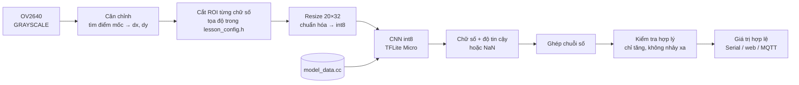
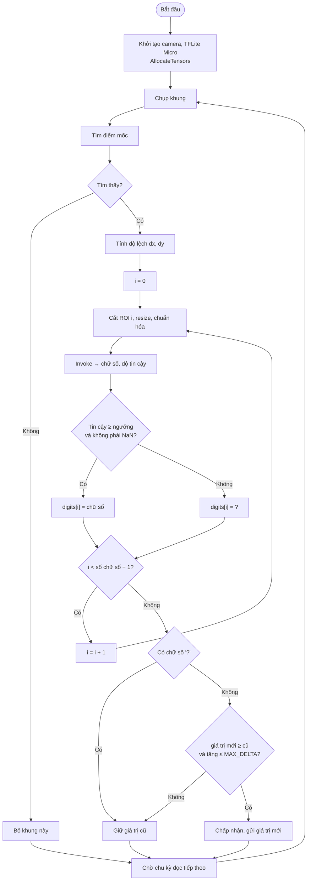

# #9 Nhận diện chữ số

> **Độ khó:** ⭐⭐⭐⭐⭐ · **Framework:** Arduino core 2.0.17 + TFLite Micro (hoặc ESP-IDF) · **Env:** `09_digit_recognition` · **Trạng thái:** ⬜ Chưa làm

Đọc số trên **đồng hồ nước** hoặc **màn hình LED 7 đoạn**: tự cắt từng chữ số, tự thiết kế và train một CNN nhỏ, lượng tử hóa int8, rồi nhúng vào firmware. Bài này không dùng Edge Impulse.

## Mục tiêu

- Tự làm toàn bộ pipeline ML: dữ liệu → Keras → TFLite int8 → mảng C → TFLite Micro.
- Thiết kế CNN nhỏ vừa vài chục KB.
- Kết hợp xử lý ảnh cổ điển (căn chỉnh, cắt ROI) với AI.
- Xử lý các trường hợp thực tế: chữ số đang lăn giữa hai giá trị, lóa, mờ.

## Kiến thức cần biết

### Các bước

1. **Camera cố định:** gắn chặt so với đồng hồ, nên vị trí các chữ số gần như không đổi.
2. **Căn chỉnh:** dùng 1–2 điểm mốc (góc khung số, logo) để bù xê dịch nhỏ. Có thể bắt đầu đơn giản với ROI cố định.
3. **Cắt ROI:** tọa độ từng chữ số đặt trong `lesson_config.h`.
4. **CNN:** mỗi chữ số được phân loại riêng thành 0–9, có thể thêm lớp `NaN` cho chữ số đang lăn hoặc không đọc được.
5. **Hậu xử lý:** đồng hồ nước chỉ tăng; nếu giá trị mới nhỏ hơn giá trị cũ hoặc nhảy quá xa thì bỏ qua.

### CNN gợi ý (cỡ vài chục KB sau int8)

```
Input 32×20×1
Conv 3×3, 16 → ReLU → MaxPool 2×2
Conv 3×3, 32 → ReLU → MaxPool 2×2
Conv 3×3, 32 → ReLU
Flatten → Dropout → Dense 10 (hoặc 11) → Softmax
```

### Lượng tử hóa int8

- **Post-training quantization:** cần một *representative dataset* (vài trăm ảnh thật) để TFLite ước lượng dải giá trị.
- Ép cả input và output về int8 để TFLite Micro không phải chuyển đổi.
- Chuyển file `.tflite` sang mảng C: `xxd -i model.tflite > model_data.cc`, hoặc dùng script Python trong `tools/`.

## Dữ liệu

| Nguồn | Ghi chú |
|---|---|
| Ảnh tự chụp từ đồng hồ thật | Quan trọng nhất; chụp nhiều thời điểm trong ngày |
| Tăng cường dữ liệu (augmentation) | Xoay ±5°, dịch vài pixel, đổi độ sáng/tương phản, làm mờ |
| Dataset của dự án AI-on-the-edge-device | Có sẵn ảnh chữ số đồng hồ đã gán nhãn; xem giấy phép trước khi dùng |
| Font 7 đoạn tự tạo | Nếu đọc LED 7 đoạn, có thể sinh ảnh tổng hợp |

## Pipeline và lưu đồ giải thuật

### Pipeline xử lý



### Lưu đồ giải thuật



## Thiết kế

```
09_digit_recognition/
├── README.md
└── src/
    ├── lesson_config.h   # Tọa độ ROI từng chữ số, ngưỡng tin cậy
    ├── main.cpp          # Chụp → căn chỉnh → cắt → suy luận → ghép số
    ├── roi.h/.cpp        # Cắt và resize ROI
    ├── model_data.cc/.h  # Model dạng mảng C (sinh tự động)
    └── web.cpp           # Ảnh có khung ROI + kết quả, chỉnh ROI
tools/
├── digits/
│   ├── collect_rois.py   # Cắt ROI từ ảnh chụp để gán nhãn
│   ├── train.py          # Keras: train + đánh giá
│   ├── quantize.py       # TFLite int8 + representative dataset
│   └── to_c_array.py     # .tflite → model_data.cc
```

## Các bước thực hiện

**Thu và gán nhãn**
- [ ] Gắn camera cố định trước đồng hồ, chụp ảnh định kỳ (ví dụ 1 phút/ảnh) trong vài ngày
- [ ] Xác định tọa độ ROI, viết `collect_rois.py` để cắt từng chữ số
- [ ] Gán nhãn vào các thư mục `0/` … `9/` (và `NaN/`)

**Train**
- [ ] Train CNN bằng Keras với augmentation, theo dõi accuracy trên tập validation
- [ ] Lượng tử hóa int8, so sánh accuracy trước và sau lượng tử hóa
- [ ] Xuất `model_data.cc`

**Firmware**
- [ ] Thêm env, thêm thư viện TFLite Micro cho Arduino (hoặc làm bản ESP-IDF như bài #6)
- [ ] Cắt ROI trên board, **so sánh ảnh ROI với ảnh lúc train** (cùng kích thước, cùng chuẩn hóa)
- [ ] Chạy suy luận, ghép chuỗi số, thêm kiểm tra hợp lý
- [ ] Trang web hiển thị ảnh có khung ROI và số đọc được

## Tiêu chí hoàn thành

- Đọc đúng **toàn bộ chuỗi số** trong ≥ 90% lần thử.
- Model int8 ≤ 100 KB, suy luận cả chuỗi < 1 giây.

## Kết quả

| Hạng mục | Giá trị |
|---|---|
| Số ảnh chữ số (train / val / test) | _chưa có_ |
| Accuracy float32 / int8 (mỗi chữ số) | _chưa đo_ |
| Kích thước model int8 | _chưa đo_ |
| Thời gian suy luận / chữ số | _chưa đo_ |
| Đọc đúng cả chuỗi (thực tế) | _chưa đo_ |

## Khó khăn thường gặp

| Vấn đề | Gợi ý |
|---|---|
| Chính xác trên máy tính, sai trên board | Tiền xử lý trên board khác lúc train (resize, chuẩn hóa, xám); lưu ROI từ board để so sánh |
| Chữ số đang lăn bị đọc sai | Thêm lớp `NaN`, hoặc lấy giá trị gần nhất hợp lý |
| Lóa trên mặt kính | Đèn flash chiếu xiên hoặc khuếch tán; tắt flash nếu đủ sáng |
| Accuracy giảm nhiều sau int8 | Representative dataset quá ít hoặc không giống dữ liệu thật |
| `Didn't find op for builtin opcode` | Op resolver thiếu phép toán mà model dùng; thêm vào |

## Tham khảo

- [jomjol/AI-on-the-edge-device](https://github.com/jomjol/AI-on-the-edge-device): dự án đọc đồng hồ bằng ESP32-CAM, rất nên đọc
- [TensorFlow – Post-training integer quantization](https://ai.google.dev/edge/litert/models/post_training_integer_quant)
- [TensorFlow Lite Micro](https://github.com/tensorflow/tflite-micro)
- [espressif/esp-tflite-micro](https://github.com/espressif/esp-tflite-micro)

---

⬅️ [#8 Đếm vật thể (FOMO)](../08_fomo_object_counting/README.md) · ➡️ [#10 Pipeline ESP-DL](../10_esp_dl_pipeline/README.md)
