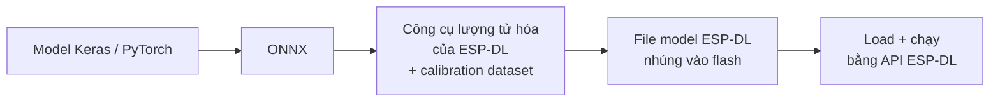
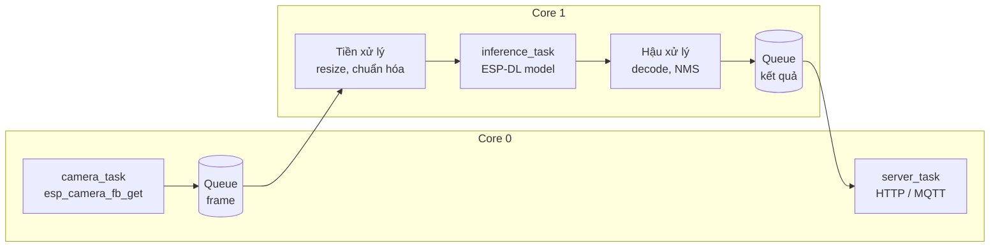
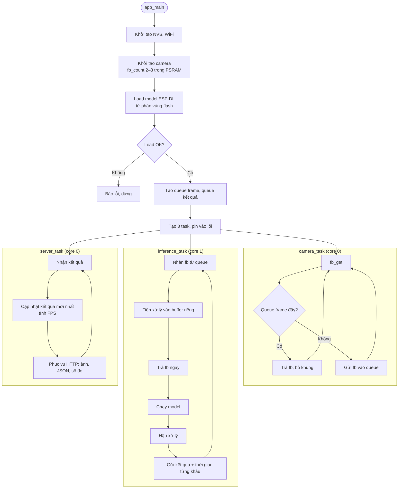

# #10 Tự viết pipeline ESP-WHO / ESP-DL

> **Độ khó:** ⭐⭐⭐⭐⭐ · **Framework:** ESP-IDF + ESP-DL · **Project:** độc lập (không dùng env ở gốc) · **Trạng thái:** ⬜ Chưa làm

Tự dựng một pipeline thị giác máy hoàn chỉnh trên ESP-IDF: camera → tiền xử lý → mô hình **ESP-DL** do mình tự chuyển đổi → hậu xử lý → kết quả. Pipeline được tối ưu bằng nhiều task FreeRTOS chạy trên cả hai lõi.

## Mục tiêu

- Làm chủ ESP-IDF ở mức hệ thống: `sdkconfig`, phân vùng flash, PSRAM, FreeRTOS.
- Chuyển một mô hình tự train (ví dụ từ bài #7 hoặc #9) sang định dạng ESP-DL bằng công cụ lượng tử hóa của Espressif.
- Thiết kế pipeline nhiều task, đo và tối ưu FPS.
- So sánh ESP-DL với TFLite Micro (bài #6, #9) trên cùng phần cứng.

## Vấn đề phải kiểm tra trước

> [!WARNING]
> Các bản ESP-DL và ESP-WHO mới chủ yếu nhắm tới **ESP32-S3** và **ESP32-P4** (có lệnh vector AI). Cần kiểm tra:
> - Phiên bản ESP-DL nào còn hỗ trợ **ESP32 thường**, và công cụ lượng tử hóa tương ứng.
> - Nếu không còn hỗ trợ, có hai lựa chọn: dùng bản ESP-DL cũ, hoặc chấp nhận làm bài này trên một board ESP32-S3 (ví dụ ESP32-S3-EYE, XIAO ESP32S3 Sense).
>
> Ghi lại quyết định và lý do vào phần **Kết quả**.

## Kiến thức cần biết

### Chuyển đổi mô hình



Tên công cụ và định dạng file cụ thể phụ thuộc phiên bản ESP-DL được chọn.

### Tối ưu có thể thử

| Kỹ thuật | Kỳ vọng |
|---|---|
| CPU 240 MHz, PSRAM 80 MHz, flash QIO | Tăng tốc toàn hệ thống |
| Tách task, pin vào lõi | Tăng FPS nhờ chạy song song |
| Giảm độ phân giải đầu vào | Suy luận nhanh hơn, có thể kém chính xác hơn |
| Lượng tử hóa int8 so với int16 | int8 nhanh hơn, int16 chính xác hơn |
| Cấu hình cache, đặt hàm nóng vào IRAM | Giảm cache miss |

## Pipeline và lưu đồ giải thuật

### Pipeline xử lý (nhiều task)



- **Tách task:** khi lõi 1 đang suy luận khung N thì lõi 0 đã chụp khung N+1, nên FPS gần bằng thời gian của **khâu chậm nhất** chứ không phải tổng các khâu.
- **Frame buffer:** `fb_count = 2` hoặc 3 trong PSRAM; phải trả buffer (`esp_camera_fb_return`) càng sớm càng tốt.
- **Bộ nhớ:** model và tensor trung gian đặt trong PSRAM, phần nóng đặt trong internal RAM. Đo bằng `heap_caps_get_free_size()`.

### Lưu đồ giải thuật



## Thiết kế

```
10_esp_dl_pipeline/
├── README.md
├── CMakeLists.txt
├── partitions.csv          # Phân vùng chứa model
├── sdkconfig.defaults
├── model/                  # Model đã chuyển đổi (hoặc link tải)
└── main/
    ├── CMakeLists.txt
    ├── idf_component.yml   # esp-dl, esp32-camera
    ├── app_main.cpp        # Tạo queue, task
    ├── camera_task.cpp
    ├── inference_task.cpp
    ├── postprocess.cpp
    └── server_task.cpp     # HTTP: ảnh + kết quả + số đo hiệu năng
tools/
└── esp_dl/
    ├── export_onnx.py
    └── quantize.py         # Gọi công cụ lượng tử hóa với calibration dataset
```

## Các bước thực hiện

**Chuẩn bị**
- [ ] Kiểm tra phiên bản ESP-DL hỗ trợ ESP32; quyết định board
- [ ] Build và chạy một ví dụ có sẵn của ESP-DL hoặc ESP-WHO để chắc chắn toolchain hoạt động

**Pipeline cơ bản (một task)**
- [ ] Camera → tiền xử lý → model mẫu của ESP-DL → in kết quả
- [ ] Đo thời gian từng khâu bằng `esp_timer_get_time()`

**Model riêng**
- [ ] Chọn model (từ bài #7 hoặc #9), xuất ONNX
- [ ] Lượng tử hóa bằng công cụ của ESP-DL, kiểm tra độ chính xác trên máy tính
- [ ] Nhúng vào firmware, so sánh đầu ra trên board với trên máy tính (cùng một ảnh)

**Tối ưu**
- [ ] Tách thành nhiều task, dùng queue, pin vào lõi
- [ ] Đo FPS, CPU load mỗi lõi, heap còn lại
- [ ] Thử các kỹ thuật trong bảng tối ưu, ghi kết quả từng bước

**So sánh**
- [ ] Cùng model đó chạy bằng TFLite Micro (như bài #6, #9) và ESP-DL: so sánh thời gian, RAM, độ chính xác

## Tiêu chí hoàn thành

- Chạy được một mô hình **tự chuyển đổi** bằng ESP-DL trên board.
- Pipeline nhiều task, có số đo FPS trước và sau khi tối ưu.
- Có bảng so sánh với bài #6 và #8.

## Kết quả

| Hạng mục | Giá trị |
|---|---|
| Board / phiên bản ESP-IDF / ESP-DL | _chưa chọn_ |
| Model, đầu vào, kiểu lượng tử hóa | _chưa có_ |
| FPS một task | _chưa đo_ |
| FPS nhiều task | _chưa đo_ |
| Thời gian: chụp / tiền xử lý / suy luận / hậu xử lý | _chưa đo_ |
| Heap internal / PSRAM còn lại | _chưa đo_ |

| So sánh | Bài #6 (TFLM) | Bài #8 (EI) | Bài #10 (ESP-DL) |
|---|---|---|---|
| Thời gian suy luận | | | |
| RAM | | | |
| FPS toàn pipeline | | | |

## Khó khăn thường gặp

| Vấn đề | Gợi ý |
|---|---|
| Ví dụ ESP-WHO không build cho ESP32 | Bản mới chỉ hỗ trợ S3/P4; xem phần cảnh báo |
| Lượng tử hóa xong sai hoàn toàn | Tiền xử lý (mean/std, thứ tự kênh, layout NHWC/NCHW) khác lúc train |
| Watchdog reset | Task suy luận chiếm lõi quá lâu; thêm `vTaskDelay` ngắn hoặc chỉnh task watchdog |
| Thiếu bộ nhớ khi tạo task | Stack task đặt quá lớn; cấp stack trong PSRAM hoặc giảm stack |
| FPS không tăng khi tách task | Khâu chậm nhất vẫn nằm trên một lõi; cân bằng lại công việc giữa hai lõi |

## Tham khảo

- [espressif/esp-dl](https://github.com/espressif/esp-dl): tài liệu, ví dụ, công cụ lượng tử hóa
- [espressif/esp-who](https://github.com/espressif/esp-who)
- [ESP-IDF – FreeRTOS](https://docs.espressif.com/projects/esp-idf/en/stable/esp32/api-reference/system/freertos.html)
- [ESP-IDF – Performance / Speed optimization](https://docs.espressif.com/projects/esp-idf/en/stable/esp32/api-guides/performance/speed.html)
- [ESP-IDF – Support for external RAM](https://docs.espressif.com/projects/esp-idf/en/stable/esp32/api-guides/external-ram.html)

---

⬅️ [#9 Nhận diện chữ số](../09_digit_recognition/README.md) · 🏠 [Về README chính](../../README.md)
